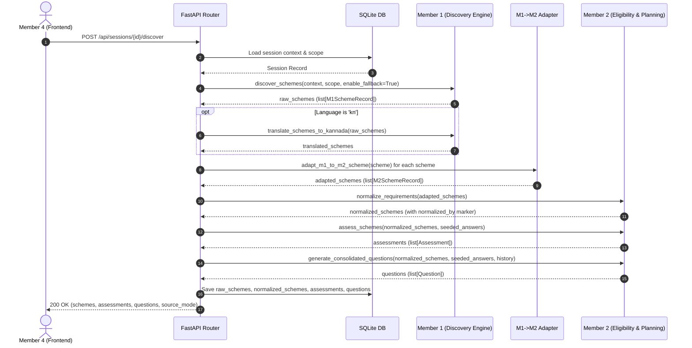

# Member 3 — Coding Round 1 Plan (Integrated Orchestration & Backend)

> **Role:** Technical Lead · Backend · SQLite · Orchestration · Integration  
> **Milestone:** Review Round 1 (target: 7:00 PM, October 31)  
> **Working Branch:** `main` (Unified master containing Agent 1 & Agent 2/3 codebases)  
> **Primary Objective:** Build the central FastAPI orchestrator, SQLite session persistence, and M1 $\leftrightarrow$ M2 schema adapter to deliver the review-ready **Context Seed → Discovery (M1) → Schema Adapter → Normalization & Initial Assessment (M2) → Consolidated Questions (M2) → Answer Submission & Reassessment (M2) → Document Planning DAG (M2) → Session Persistence (SQLite)** end-to-end slice.

---

## 1. Mission and Definition of Success

Member 3 owns the shared infrastructure, persistence, adapter layer, and orchestration that binds the team's work into a single unified product. Member 3 does **not** reimplement discovery search or scheme extraction (owned by Member 1), nor eligibility assessment, question ranking, or topological DAG planning (owned by Member 2).

Because **Member 1** has delivered the Discovery Agent (`discovery_agent/`) with official domain search, verified offline fallbacks, and Kannada translation, and **Member 2** has delivered the complete Eligibility & Planning Agent (`member2/`) with 282 passed offline tests, Member 3's Coding Round 1 deliverable is **no longer a stubbed mock**, but a **fully functioning, integrated vertical slice**.

By the end of Coding Round 1, the definition of success is:

1. **FastAPI starts locally** and exposes operational readiness at `/health` and `/api/health`.
2. **SQLite Session Durability:** Sessions create, store, update, restore, and delete all citizen state across all workflow stages.
3. **M1-to-M2 Schema Adapter:** Member 1's discovered schemes (`discovery_agent.scheme_schema.SchemeRecord`) are seamlessly adapted into Member 2's requirement model (`member2.models.SchemeRecord`) without manual schema rewrites.
4. **Context-Answer Seeding:** Initial profile context from the session form is automatically seeded into Member 2's answer and question history, preventing redundant questions for already-known profile attributes.
5. **End-to-End Discovery Pipeline:** Calling discovery triggers Member 1 live search (or verified fallbacks), translates to Kannada if requested, adapts the records, normalizes requirements via Member 2, calculates preliminary assessments, and generates the first batch of consolidated cross-scheme questions.
6. **Consolidated Questions & Reassessment Flow:** Users can retrieve ranked questions with UI options/ranges, submit answers, skips, or "not sure", and immediately receive updated, non-destructive scheme assessments.
7. **Document Action Plan DAG:** Users can request the document procurement action plan, receiving a topologically sorted checklist and prerequisite DAG edges derived strictly from official source requirements.
8. **Document Checklist Tracking:** Users can update document procurement states (`have`, `obtained`, `needed`), and the DAG dynamically recalculates remaining steps.
9. **Frontend-Unblocking API:** Member 4 has a live, documented, stable REST API with realistic fixtures and active endpoints.
10. **The Complete 6-Stage Demo Path Passes:** Context $\rightarrow$ Discovery $\rightarrow$ Consolidated Questions $\rightarrow$ Reassessment $\rightarrow$ Document Plan $\rightarrow$ Session Restore runs green in dry runs.

---

## 2. Team Ownership and Actual Code Boundaries

| Member | Module Ownership | Implemented Codebase | Member 3 Integration Boundary |
|---|---|---|---|
| **Member 1** | Discovery Agent & Kannada Translator | `discovery_agent/`<br/>• `discovery_pipeline.py`<br/>• `fallback_schemes.py`<br/>• `kannada_translator.py`<br/>• `scheme_schema.py`<br/>• `search_provider.py`<br/>• `scheme_extractor.py` | In-process call to `discover_schemes(user_context, search_scope, enable_fallback=True)` and `translate_schemes_to_kannada(schemes)`. |
| **Member 2** | Eligibility, Assessment, Consolidated Questions, & Document Planning DAG | `member2/`<br/>• `models.py`<br/>• `attributes.py`<br/>• `normalize.py`<br/>• `assess.py`<br/>• `questions.py`<br/>• `planning.py`<br/>• `llm.py`<br/>• `documents.py` | In-process calls to `normalize_requirements`, `assess_schemes`, `generate_consolidated_questions`, `apply_answers`, `reassess_schemes`, and `build_action_plan`. |
| **Member 3** | Central Orchestrator, SQLite Persistence, Schema Adapter, REST API | `api/` / `backend/`<br/>• `api/main.py`<br/>• `api/schemas.py`<br/>• `api/database.py`<br/>• `api/adapter.py`<br/>• `api/orchestrator.py` | Connects M1 and M2; persists all state in SQLite; exposes REST endpoints to Member 4. |
| **Member 4** | Frontend (React / Vite / Tailwind / Stitch UX) | `frontend/` (or UI client) | Consumes REST API endpoints and data schemas. |

### Explicitly Out of Scope for Member 3
- Reimplementing web scraping, Tavily queries, or claim extraction (owned by Member 1).
- Reimplementing interval comparators, question ranking weights, or topological sort algorithms (owned by Member 2).
- Implementing Action Agent P1 artifacts (RTI inquiry email drafts, `.ics` generation) during Round 1.
- Direct frontend styling or UI component implementation (owned by Member 4).
- Pushing unverified branches to GitHub before team sync.

---

## 3. Execution Principles

1. **Contracts before Integration:** Do not modify the core algorithms inside `discovery_agent/` or `member2/`. Bridge discrepancies strictly in the Member 3 adapter layer.
2. **In-Process Python Execution:** Call Member 1 and Member 2 modules in-process. Avoid inter-service HTTP overhead and separate background processes during the hackathon.
3. **Context Seeding:** Seed answers from the context form with `member2.apply_answers({}, {}, context_form_answers)` (setting state to `answered`). Questions for known attributes (e.g., district, income, occupation) must not be re-asked.
4. **Normalize Once and Persist:** Run `normalize_requirements()` once per discovery run and persist the resulting normalized schemes in SQLite. Normalized schemes carry the `normalized_by` marker that prevents redundant, costly LLM calls on subsequent operations.
5. **Unknown is Never False:** Missing answers, skipped questions, and "not sure" selections remain `AnswerState.unknown`. In Member 2's evaluator, this yields `RequirementStatus.unknown` and `SchemeStatus.more_information_needed`—never `not_satisfied` or `unlikely_to_match`.
6. **Pass Keyword Arguments to Planning:** Always call `member2.build_action_plan(selected, *, user_documents=..., assessments=...)` using keyword arguments after the first argument to match Member 2's signature.
7. **Persist Exact History:** Maintain `history: dict[str, AnswerState]` mapping `"q_" + attribute` to its last state. Member 2's question generator relies on this to ensure previously answered/skipped questions are never re-asked in consolidated batches.
8. **Session-Scoped Operations:** Every state modification (discovery, answering, checklist update) requires a valid `session_id`.
9. **Privacy by Design:** Store only necessary civic profile details. Strictly reject and exclude Aadhaar numbers, OTPs, biometric data, or identity document scans.
10. **Evidence Grounding:** Preserve official source URLs and verbatim excerpts across all transformed scheme records and prerequisite graph edges.

---

## 4. Phase 0 — Workspace & Unified Package Layout

Consolidate the backend into a clean, unified architecture built upon the existing `api/` directory:

```text
Unlocked/
├── api/
│   ├── __init__.py
│   ├── main.py              # FastAPI app, lifespan, CORS, route definitions
│   ├── schemas.py           # Public Pydantic request/response schemas for Member 4
│   ├── database.py          # aiosqlite connection manager and CRUD operations
│   ├── adapter.py           # M1 (discovery_agent) <-> M2 (member2) schema bridge
│   └── orchestrator.py      # Master workflow coordinator executing M1 and M2 pipelines
├── discovery_agent/         # Member 1 Discovery codebase
│   ├── discovery_pipeline.py
│   ├── fallback_schemes.py
│   ├── kannada_translator.py
│   └── scheme_schema.py
├── member2/                 # Member 2 Eligibility & Planning codebase
│   ├── models.py
│   ├── attributes.py
│   ├── normalize.py
│   ├── assess.py
│   ├── questions.py
│   ├── planning.py
│   └── documents.py
├── data/                    # SQLite database store (gitignored)
│   └── unlocked.db
├── tests/
│   ├── test_api.py          # Member 1 & 3 API endpoint tests
│   ├── test_orchestrator.py # Member 3 end-to-end integration tests
│   └── member2/             # Member 2 offline test suite (282 tests)
├── requirements.txt         # Unified dependencies
└── .env                     # Local credentials (GEMINI_API_KEY, TAVILY_API_KEY)
```

### Dependencies
Ensure the project's virtual environment installs:
```text
fastapi>=0.110.0
uvicorn[standard]>=0.28.0
pydantic>=2.6.0
aiosqlite>=0.20.0
python-dotenv>=1.0.0
httpx>=0.27.0
pytest>=8.0.0
pytest-asyncio>=0.23.0
networkx>=3.2
google-genai>=1.0.0
tavily-python>=0.5.0
rich>=13.0.0
```

---

## 5. Phase 1 — Frozen Contracts and Interfaces

### 5.1 Member 1 Public Interface (`discovery_agent`)
```python
async def discover_schemes(
    user_context: dict,
    search_scope: str = "guided",      # "guided" | "all" | "fallback"
    enable_fallback: bool = True
) -> list[discovery_agent.scheme_schema.SchemeRecord]: ...

async def translate_schemes_to_kannada(
    schemes: list[discovery_agent.scheme_schema.SchemeRecord]
) -> TranslationResult: ...  # NamedTuple: (schemes, warnings, translation_status, actual_response_language)
```

### 5.2 Member 2 Public Interface (`member2`)
```python
# 1. Normalization (idempotent, supports Gemini/Claude/offline)
def normalize_requirements(
    schemes: Iterable[SchemeInput],
    llm: Optional[LLMClient] = None
) -> list[member2.models.SchemeRecord]: ...

# 2. Scheme Assessment
def assess_schemes(
    schemes: Iterable[SchemeInput],
    user_answers: AnswersInput = None,
    *,
    now: Optional[datetime] = None
) -> list[member2.models.Assessment]: ...

# 3. Consolidated Cross-Scheme Question Generation
def generate_consolidated_questions(
    schemes: Iterable[SchemeInput],
    user_answers: AnswersInput = None,
    question_history: HistoryInput = None,
    *,
    batch_size: int = 5,
    llm: Optional[LLMClient] = None
) -> list[member2.models.Question]: ...

# 4. Answer Application & Normalization
def apply_answers(
    answers: Mapping[str, Answer] | None,
    history: Mapping[str, AnswerState] | None,
    submitted: Any
) -> tuple[dict[str, Answer], dict[str, AnswerState]]: ...

# 5. Reassessment
def reassess_schemes(
    schemes: Iterable[SchemeInput],
    user_answers: AnswersInput = None,
    *,
    now: Optional[datetime] = None
) -> list[member2.models.Assessment]: ...

# 6. Deterministic Document Planning & Topological DAG Sort
def build_action_plan(
    selected_schemes: Iterable[SchemeInput],
    *,
    user_documents: Optional[Mapping[str, DocStatus | str]] = None,
    assessments: Optional[Iterable[Assessment | dict]] = None
) -> member2.models.ActionPlan: ...
```

### 5.3 M1-to-M2 Schema Adapter (`api/adapter.py`)
Because Member 1 extracts `eligibility_criteria` (as `SchemeCriterion`) and flat document strings, while Member 2 expects `requirements` (as `Requirement`) and structured `DocumentRequirement` objects, Member 3 provides the canonical adapter bridge.

> [!IMPORTANT]
> **Production Implementation In Place:** Member 1 has already implemented and tested this transformation in [`discovery_agent/adapter.py`](file:///home/kruthik/coding/Unlocked/discovery_agent/adapter.py) (`adapt_m1_to_m2_scheme` / `to_canonical_scheme`). It resolves canonical attributes via `member2.attributes.resolve_attribute()`, prefixes unmapped attributes with `unmapped:`, normalizes operators to `Operator` enums, and attaches `source_url` and `evidence` to all documents so Agent 3 never excludes them from the checklist.
>
> In `api/adapter.py`, Member 3 simply re-exports the verified engine:
> ```python
> """
> api/adapter.py — Canonical adapter bridging Member 1 discovery schemas to Member 2 contracts.
> """
> from discovery_agent.adapter import (
>     adapt_m1_to_m2_scheme,
>     adapt_m1_to_m2_schemes,
>     to_canonical_scheme,
>     to_canonical_schemes,
> )
> 
> __all__ = [
>     "adapt_m1_to_m2_scheme",
>     "adapt_m1_to_m2_schemes",
>     "to_canonical_scheme",
>     "to_canonical_schemes",
> ]
> ```

---

## 6. Phase 2 — FastAPI & SQLite Session Persistence

### 6.1 Database Table (`data/unlocked.db`)

```sql
CREATE TABLE IF NOT EXISTS sessions (
    session_id TEXT PRIMARY KEY,
    scope TEXT NOT NULL,
    preferred_language TEXT NOT NULL,
    state_status TEXT NOT NULL,
    context_json TEXT NOT NULL,
    raw_schemes_json TEXT,
    normalized_schemes_json TEXT,
    questions_json TEXT,
    answers_json TEXT,
    history_json TEXT,
    assessments_json TEXT,
    plan_json TEXT,
    user_documents_json TEXT,
    created_at TIMESTAMP DEFAULT CURRENT_TIMESTAMP,
    updated_at TIMESTAMP DEFAULT CURRENT_TIMESTAMP
);
```

### 6.2 Session State Machine
```text
[EMPTY_SESSION]
       │
       ▼ POST /api/sessions (save context, seed initial answers)
[CONTEXT_INITIALIZED]
       │
       ▼ POST /api/sessions/{id}/discover (M1 discover + adapt + M2 normalize + assess + questions)
[DISCOVERY_COMPLETE]
       │
       ▼ POST /api/sessions/{id}/answers (M2 apply_answers + reassess + update history)
[ASSESSMENT_UPDATED]
       │
       ▼ GET /api/sessions/{id}/plan (M2 build_action_plan DAG)
[PLAN_GENERATED]
```

### 6.3 Async Database CRUD Operations (`api/database.py`)
- `init_db()`: Initializes database schema and enables SQLite WAL mode.
- `create_session(session_id, context, scope, language)`: Stores initial context, seeds initial answers/history via `apply_answers`, and sets state to `CONTEXT_INITIALIZED`.
- `get_session(session_id)`: Loads session record and deserializes JSON fields.
- `update_discovery_results(session_id, raw_schemes, normalized_schemes, questions, assessments)`: Persists discovery state.
- `update_answers_and_assessments(session_id, answers, history, assessments)`: Persists answer map, question history, and updated assessments.
- `update_plan(session_id, plan, user_documents)`: Persists action plan DAG and document statuses.
- `delete_session(session_id)`: Removes the session and associated citizen data.

---

## 7. Phase 3 — End-to-End Discovery Pipeline Integration

When `POST /api/sessions/{session_id}/discover` is called:



---

## 8. Phase 4 — Consolidated Questions & Reassessment Flow

Member 4 presents the 3–5 consolidated questions to the citizen.

### 8.1 Retrieval (`GET /api/sessions/{session_id}/questions`)
Returns the active question batch persisted in SQLite, including:
- `id`: Opaque ID (`q_annual_family_income`, `q_caste_category`).
- `question`: User-friendly question text.
- `input_type`: `number`, `range`, `select`, `boolean`, or `text`.
- `options` / `ranges`: UI options or income bands (`min`, `max`, `label`).
- `why_asked`: Transparent explanation (e.g., *"Needed for 3 of the schemes we found."*).
- `sensitivity`: `low`, `medium`, or `high`.
- `allow_prefer_not_to_answer`: `True`.

### 8.2 Submission & Reassessment (`POST /api/sessions/{session_id}/answers`)
```python
# In orchestrator.py
answers, history = apply_answers(session.answers, session.history, submitted_answers)
updated_assessments = reassess_schemes(session.normalized_schemes, answers)
next_questions = generate_consolidated_questions(
    session.normalized_schemes,
    answers,
    history,
    batch_size=5
)
await db.update_answers_and_assessments(
    session_id=session_id,
    answers=answers,
    history=history,
    assessments=updated_assessments,
    questions=next_questions
)
```

#### Answer Format Rules
- **Income Range**: `{"min": 100000, "max": 250000}` or label `"Rs. 1,00,001 - Rs. 2,50,000"`.
- **Select**: One of `Question.options`.
- **Boolean**: `true`, `false`, `"Yes"`, or `"No"`.
- **"Not Sure" / Skip / Prefer Not to Answer**: State flag:
  `{"attribute": "caste_category", "state": "unknown"}`.  
  Evaluates to `RequirementStatus.unknown` $\rightarrow$ `SchemeStatus.more_information_needed`.

---

## 9. Phase 5 — Document Planning & DAG Checklist Flow

### 9.1 Action Plan Generation (`GET /api/sessions/{session_id}/plan`)
Member 3 retrieves `normalized_schemes` and current document statuses, then invokes:
```python
plan = build_action_plan(
    session.normalized_schemes,
    user_documents=session.user_documents,
    assessments=session.assessments
)
await db.save_plan(session_id, plan)
```

#### Output Returned to Member 4:
- `checklist`: Ordered `ChecklistItem` list sorted by:
  1. Unobtained documents first (`needed` before `have`/`obtained`).
  2. Number of schemes unlocked (higher leverage first).
  3. Earliest verified deadline date.
- `nodes`: Document nodes and scheme nodes.
- `edges`: Verified prerequisite edges (`required_for`, `prerequisite_of`).
- `shared_prerequisites`: Document IDs unlocking 2+ schemes (e.g. `doc_income_certificate`, `doc_aadhaar`).
- `explanation`: Human-readable summary of procurement steps.

### 9.2 Checklist Item Status Update (`POST /api/sessions/{session_id}/checklist/{doc_id}`)
When the user toggles a document (e.g. from `needed` to `have` or `obtained`):
1. Update `user_documents[doc_id] = new_status`.
2. Re-run `build_action_plan(schemes, user_documents=user_documents, assessments=assessments)`.
3. The topological sort immediately unblocks downstream dependent documents without removing completed items from the plan view.

---

## 10. Phase 6 — REST API Specification for Member 4

| Method | Endpoint | Description | Request Body | Response |
|---|---|---|---|---|
| `GET` | `/health` | Service readiness and API key status | None | `HealthResponse` |
| `POST` | `/api/sessions` | Create session & seed context answers | `CreateSessionRequest` | `SessionResponse` |
| `GET` | `/api/sessions/{id}` | Restore complete session state | None | `FullSessionState` |
| `DELETE` | `/api/sessions/{id}` | Reset/delete session and citizen data | None | `{"deleted": true}` |
| `POST` | `/api/sessions/{id}/discover` | Execute discovery, translation, & assessment | `DiscoverOptions` | `DiscoveryResult` |
| `GET` | `/api/sessions/{id}/schemes` | Get schemes with current assessments | None | `list[SchemeView]` |
| `GET` | `/api/sessions/{id}/schemes/{scheme_id}` | Get single scheme details | None | `SchemeView` |
| `GET` | `/api/sessions/{id}/questions` | Get active consolidated questions | None | `list[Question]` |
| `POST` | `/api/sessions/{id}/answers` | Submit answers & trigger reassessment | `SubmitAnswersRequest` | `ReassessmentResult` |
| `GET` | `/api/sessions/{id}/plan` | Compute & return document action plan DAG | None | `ActionPlan` |
| `POST` | `/api/sessions/{id}/checklist/{doc_id}` | Update document procurement status | `{"status": "obtained"}`| `ActionPlan` |

---

## 11. Phase 7 — Automated Tests and Dry-Run Verification

### Test Suites to Run
1. **Member 2 Suite (282 tests):**
   ```bash
   python -m pytest tests/member2 -q
   ```
   Must remain 100% passing offline without network or paid API keys.
2. **Member 1 Discovery & Translation Suite:**
   ```bash
   python -m pytest tests/test_discovery.py tests/test_extended_discovery.py tests/test_kannada.py -q
   ```
   *(Note: `tests/test_api.py` and `tests/test_orchestrator.py` will be created fresh for the new FastAPI endpoints).*
3. **M1 $\leftrightarrow$ M2 Schema Adapter Verification:**
   ```bash
   python -m member2.check_member1 tests/member2/fixtures/schemes.json
   ```
4. **Member 3 End-to-End Orchestrator Integration Test:**
   Create and run `tests/test_orchestrator.py` verifying the full state lifecycle in SQLite:
   - Create session with initial farmer profile.
   - Run discovery (verifying M1 $\rightarrow$ Adapter $\rightarrow$ M2 normalization).
   - Verify initial questions are generated and known profile attributes are excluded.
   - Submit answers (including an explicit "not sure").
   - Verify scheme reassessment updates from `more_information_needed` to `potential_match`.
   - Generate action plan DAG and verify topological order.
   - Update checklist item and confirm re-sorting.
   - Restore session via `GET /api/sessions/{id}` and confirm all JSON fields match.

---

## 12. Review Round 1 Demo Walkthrough (90 Seconds)

1. **Service Health Check (`GET /health`):**
   Show operational readiness; Gemini and Tavily credentials verified without leaking secrets.
2. **Session Creation (`POST /api/sessions`):**
   Submit student/farmer context (`Mandya`, `Karnataka`, `annual_income=150000`). Show session initialized.
3. **Discovery Execution (`POST /api/sessions/{id}/discover`):**
   Trigger discovery. Show schemes returned with official `.gov.in` source links and verified claim excerpts. Highlight `source_type: "live_search"` (or `"fallback"` if offline).
4. **Initial Assessment & Questions (`GET /api/sessions/{id}/questions`):**
   Display the 3–5 consolidated cross-scheme questions. Note that the question for annual income was automatically seeded from the context form and is **not** re-asked.
5. **Answer Submission & Non-Destructive Skip (`POST /api/sessions/{id}/answers`):**
   Submit an answer for landholding and select "Not sure" for another. Show that "Not sure" evaluates to `more_information_needed` and **never** disqualifies the citizen.
6. **Document Planning DAG (`GET /api/sessions/{id}/plan`):**
   Display the topologically sorted checklist. Point out shared prerequisites (e.g. Aadhaar Card and RD Income Certificate unlocking multiple schemes).
7. **Session Durability Restore (`GET /api/sessions/{id}`):**
   Restart or reload session from SQLite, proving complete state persistence.

---

## 13. Time-boxed Execution Roadmap (Coding Round 1)

| Time Window | Focus Area | Deliverable |
|---|---|---|
| **00:00 – 00:20** | Environment & Package Alignment | Merge dependencies into `requirements.txt`, verify imports from `discovery_agent` and `member2`. |
| **00:20 – 00:40** | Package Setup & Adapter Wire-Up (`api/adapter.py`) | Re-export `discovery_agent.adapter`, verify contract pass with `member2.check_member1`. |
| **00:40 – 01:15** | SQLite Session Store (`api/database.py`) | Implement async database operations (`aiosqlite`) with WAL mode. |
| **01:15 – 01:50** | Central Orchestrator (`api/orchestrator.py`) | Wire discovery $\rightarrow$ adapter $\rightarrow$ normalize $\rightarrow$ assess $\rightarrow$ questions $\rightarrow$ plan. |
| **01:50 – 02:20** | API Routes Integration (`api/main.py`) | Expose session CRUD, discovery, questions, answers, and plan endpoints. |
| **02:20 – 02:45** | Integration Testing & Dry Run | Run automated test suite and execute the 90-second Review 1 walkthrough. |

---

## 14. Risks and Mitigations

| Risk | Impact | Mitigation Strategy |
|---|---|---|
| **M1 / M2 Field Drift** | Extraction attributes do not match M2 registry | M1-to-M2 adapter normalizes field names; unknown attributes gracefully become `unmapped:*` with status `needs_clarification` (never crash). |
| **LLM Rate Limit / Timeout** | Discovery pipeline hangs during demo | Fallback collection (`fallback_schemes.py`) activates automatically if Tavily or Gemini times out; `DISCOVERY_TIMEOUT_SECONDS=45.0` prevents blocked requests. |
| **Question Redundancy** | User asked for info already provided | Context answer seeding in `create_session()` populates `history` so known attributes are skipped. |
| **Database Concurrency** | SQLite locks on concurrent async writes | Enable SQLite WAL mode (`PRAGMA journal_mode=WAL; PRAGMA busy_timeout=5000;`). |
| **Missing API Keys on Demo Machine** | Failure during offline presentation | Member 2 runs 100% offline; Member 1 fallback schemes function without internet or API keys. |

---

## 15. Definition of Done (Coding Round 1)

- [ ] `M3_Coding_Round_1_Plan.md` reflects actual codebases from Member 1 and Member 2.
- [ ] Dependencies consolidated and installable via `pip install -r requirements.txt`.
- [ ] M1-to-M2 Adapter tested and operational.
- [ ] SQLite database initializes with table schema including question history and document states.
- [ ] FastAPI exposes all planned REST endpoints with Pydantic request/response validation.
- [ ] Context answers are seeded into initial session state.
- [ ] Discovery runs M1 search/fallback $\rightarrow$ M2 normalization $\rightarrow$ M2 assessment.
- [ ] Question retrieval and answer submission flow recalculates assessments.
- [ ] Document action plan DAG computes topologically sorted checklist with shared prerequisites.
- [ ] Session restore proves full SQLite persistence across server restarts.
- [ ] All 282 Member 2 tests and Member 1 tests pass.
- [ ] 90-second Review Round 1 demo script runs smoothly.
