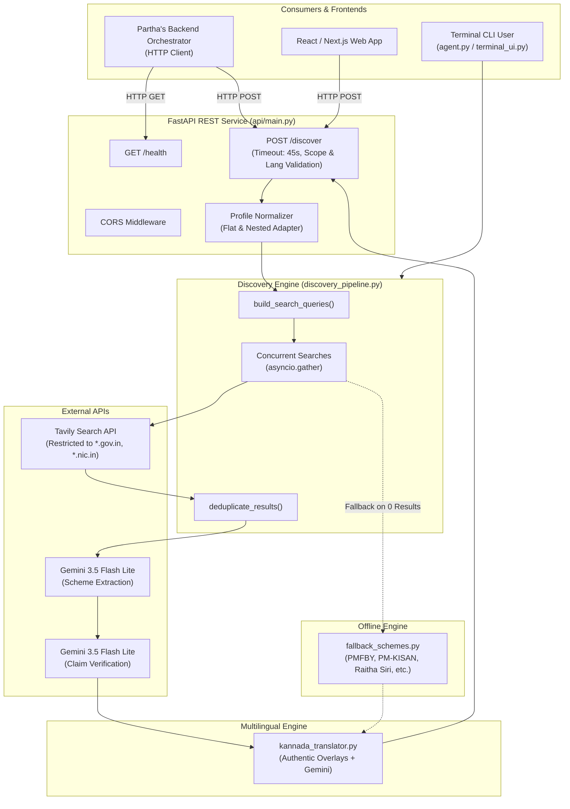

# Project Unlocked — Government Benefits & Scheme Discovery Platform

> **Autonomous Discovery Agent & Evidence-Based Verification Engine with FastAPI & Kannada Support**  
> *Karnataka & Central Government Welfare Schemes Discovery Platform*

---

## 1. Project Overview

**Project Unlocked** is an AI-powered public benefit discovery platform designed to connect Indian citizens—including farmers, students, job seekers, small business owners, women entrepreneurs, and senior citizens—with social welfare and financial assistance programs they are eligible for, with an initial focus on **Karnataka** state and **Central Government** schemes.

Navigating government welfare systems in India is challenging due to fragmented information across departmental portals, outdated third-party blogs, bureaucratic jargon, and complex eligibility criteria. Unlocked solves this by combining **live web search restricted to official government domains** (`.gov.in` and `.nic.in`) with **LLM-driven structured extraction**, **strict multi-gate claim verification**, **production-ready FastAPI endpoints**, and **native Kannada language (ಕನ್ನಡ) support**.

---

## 2. Problem Unlocked Solves

1. **Information Fragmentation**: Government schemes are scattered across hundreds of separate union and state department websites.
2. **Misinformation & Stale Advice**: Commercial blogs and aggregators frequently publish outdated or fabricated eligibility criteria, dead application links, or inaccurate subsidy numbers.
3. **Language Barriers**: Millions of rural citizens in Karnataka communicate primarily in Kannada and struggle with complex English administrative language.
4. **Complex Eligibility Rules**: Citizens often do not know which schemes apply to their demographic profile, landholding status, income level, or occupation.
5. **Lack of Evidence**: Existing search engines produce links without verifying whether factual claims (e.g. subsidy amounts, age caps, documents needed) are backed by authoritative sources.

---

## 3. Main Features

- **Guided Discovery**: Generates focused search queries targeted to a citizen's occupation, district, state, and specific interests.
- **Discover All**: Broadens discovery across welfare, subsidies, financial assistance, and health/education programs beyond explicitly stated interests.
- **FastAPI Production REST API**: High-performance asynchronous HTTP service with `/health` and `/discover` endpoints, request validation, CORS middleware, and clean error masking.
- **Native Kannada Support (ಕನ್ನಡ)**: High-quality translation of scheme names, descriptions, criteria, benefits, documents, and application steps into authentic Kannada, using pre-translated overlays for fallback schemes and dynamic Gemini translation for live schemes.
- **Strict Official-Domain Enforcement**: Restricts web retrieval exclusively to official government domains (`.gov.in`, `.nic.in`), filtering out commercial blogs and aggregators.
- **Evidence-Grounded Extraction**: Uses Gemini to extract structured `SchemeRecord` instances, isolating factual claims across 5 categories (benefits, eligibility, documents, description, application process).
- **Independent 3-Gate Claim Verification**: Every claim is cross-checked:
  1. LLM evaluates explicit support.
  2. Source URL must match an accepted official domain excerpt.
  3. The supporting excerpt quotation must be a literal substring of the official source text.
- **Resilient Search with Backoff & Jitter**: Retries transient Tavily rate limits (HTTP 429), timeouts, and 5xx server errors with exponential backoff and jitter. Preserves partial results if one query fails.
- **Manually Verified Karnataka Fallback Collection**: Provides 5 offline, pre-verified fallback schemes (PMFBY, PM-KISAN, Raitha Siri, Vidyasiri, PMKSY) clearly labeled as fallback data when live connectivity is unavailable.
- **Conversational Profile Manager**: Terminal-based chat interface that gathers user demographics and saves them to local profile storage.
- **Rich Terminal UI**: Command-line presentation using Rich tables, panels, and verification badges.

---

## 4. Technology Stack & Architecture Status

### Stack in Use
- **Language**: Python 3.14.6
- **Web Framework**: FastAPI 0.162.0 with Uvicorn ASGI server
- **LLM Provider & SDK**: Google Gemini via official `google-genai` SDK (`gemini-flash-lite-latest`)
- **Search Provider**: Tavily Search API (`tavily-python`) restricted to official domains
- **Data Modeling & Validation**: Pydantic v2 (`BaseModel`, `Field`, `Literal`, `ConfigDict`)
- **Terminal UI**: Rich (`Console`, `Table`, `Panel`, `box`)
- **Configuration & Secrets**: `python-dotenv` (`.env`)
- **Testing**: `pytest`, `pytest-asyncio`, `anyio`, `httpx` (TestClient)

### Architecture Status
| Component | Status | Details |
|---|---|---|
| **Backend REST API** | **Implemented** | FastAPI application in `api/main.py` with `/health` and `/discover` |
| **Kannada Translation** | **Implemented** | `discovery_agent/kannada_translator.py` with authentic overlays & Gemini |
| **Discovery Pipeline** | **Implemented** | Concurrent asynchronous search, deduplication, and verification |
| **Offline Fallback** | **Implemented** | 5 verified Karnataka/Central schemes in `discovery_agent/fallback_schemes.py` |
| **Terminal CLI UI** | **Implemented** | Rich visual cards in `discovery_agent/terminal_ui.py` |
| **Profile Manager** | **Implemented** | Local JSON profile manager in `discovery_agent/profile_manager.py` |
| **LangChain / LangGraph** | **Not Used** | Direct Python async + Google GenAI SDK used instead |
| **n8n Automation** | **Not Used** | No n8n workflows present |
| **Persistent Multi-User DB**| **External** | Managed by Partha's backend orchestrator |

---

## 5. System Architecture Diagram



---

## 6. API Documentation

### Running the FastAPI Server
```powershell
# Development server with auto-reload
uvicorn api.main:app --host 0.0.0.0 --port 8000 --reload
```

### Endpoints

#### 1. `GET /health`
Returns service readiness, version, and credential status.
```json
{
  "status": "healthy",
  "application": "Project Unlocked - Discovery Engine API",
  "version": "1.0.0",
  "operational": true,
  "services": {
    "gemini_configured": true,
    "tavily_configured": true
  }
}
```

#### 2. `POST /discover`
Discovers government welfare schemes for a user profile in English or Kannada.

**Sample Request (Kannada):**
```bash
curl -X POST "http://localhost:8000/discover" \
     -H "Content-Type: application/json" \
     -d '{
       "user_profile": {
         "occupation": "farmer",
         "state": "Karnataka",
         "district": "Mandya",
         "annual_income": 150000,
         "interests": ["crop insurance", "irrigation subsidy"]
       },
       "search_scope": "all",
       "preferred_language": "kn"
     }'
```

**Sample Response:**
```json
{
  "success": true,
  "preferred_language": "kn",
  "actual_response_language": "kn",
  "translation_status": "complete",
  "total_schemes": 2,
  "schemes": [
    {
      "id": "fallback-pmfby-001",
      "name": "ಪ್ರಧಾನ ಮಂತ್ರಿ ಫಸಲ್ ಬಿಮಾ ಯೋಜನೆ (PMFBY)",
      "description": "ನೈಸರ್ಗಿಕ ವಿಕೋಪಗಳು, ಕೀಟಗಳು ಮತ್ತು ರೋಗಗಳಿಂದ ಬೆಳೆ ನಷ್ಟ ಅಥವಾ ಹಾನಿಯನ್ನು ಅನುಭವಿಸುವ ರೈತರಿಗೆ ಸಮಗ್ರ ಆರ್ಥಿಕ ನೆರವು ನೀಡುವ ರಾಷ್ಟ್ರೀಯ ಬೆಳೆ ವಿಮಾ ಯೋಜನೆ.",
      "target_groups": ["ರೈತರು", "ಪಾಲುದಾರ ರೈತರು", "ಗೇಣಿದಾರ ರೈತರು"],
      "benefits": [
        "ನೈಸರ್ಗಿಕ ವಿಕೋಪಗಳಿಂದ ಉಂಟಾಗುವ ಬೆಳೆ ನಷ್ಟಕ್ಕೆ ವಿಮಾ ರಕ್ಷಣೆ",
        "ರೈತರಿಗೆ ಕಡಿಮೆ ಪ್ರೀಮಿಯಂ ದರಗಳು (ಆಹಾರ ಮತ್ತು ಎಣ್ಣೆಕಾಳುಗಳಿಗೆ 1.5% - 2%)"
      ],
      "eligibility_criteria": [
        {
          "description": "ಅಧಿಸೂಚಿತ ಪ್ರದೇಶಗಳಲ್ಲಿ ಅಧಿಸೂಚಿತ ಬೆಳೆಗಳನ್ನು ಬೆಳೆಯುವ ಎಲ್ಲಾ ರೈತರು",
          "related_attribute": "occupation",
          "source_url": "https://pmfby.gov.in",
          "verification_status": "unverified"
        }
      ],
      "required_documents": [
        "ಆಧಾರ್ ಕಾರ್ಡ್",
        "ಭೂ ದಾಖಲೆಗಳು / ಪಹಣಿ (RTC) / ಗೇಣಿ ಒಪ್ಪಂದ",
        "ಬ್ಯಾಂಕ್ ಖಾತೆ ವಿವರಗಳು"
      ],
      "application_process": "ಹತ್ತಿರದ ಬ್ಯಾಂಕ್ ಶಾಖೆ, ಸಾಮಾನ್ಯ ಸೇವಾ ಕೇಂದ್ರ (CSC) ಅಥವಾ pmfby.gov.in ಪೋರ್ಟಲ್ ಮೂಲಕ ಅರ್ಜಿ ಸಲ್ಲಿಸಿ.",
      "application_url": "https://pmfby.gov.in",
      "official_url": "https://pmfby.gov.in",
      "government_level": "central",
      "department": "ಕೃಷಿ ಮತ್ತು ರೈತರ ಕಲ್ಯಾಣ ಸಚಿವಾಲಯ",
      "verification_status": "unverified",
      "discovery_source": "fallback",
      "relevance": "direct_match",
      "match_reasons": ["Matches stated interest 'crop insurance'"],
      "missing_information": [
        "ಪ್ರಸ್ತುತ ಋತುವಿನ ಪ್ರೀಮಿಯಂ ದರಗಳು",
        "ಮಾಹಿತಿಯನ್ನು ಮರುಪರಿಶೀಲಿಸುವ ಅಗತ್ಯವಿದೆ — ಫಾಲ್‌ಬ್ಯಾಕ್ ಡೇಟಾ"
      ],
      "last_verified": "2025-01-15T00:00:00+00:00"
    }
  ],
  "warnings": [],
  "errors": []
}
```

---

## 7. How to Run Tests

```powershell
# Run the complete test suite (72 tests)
.\venv\Scripts\python.exe -m pytest tests/ -v

# Run only FastAPI endpoint tests
.\venv\Scripts\python.exe -m pytest tests/test_api.py -v

# Run only Kannada translation tests
.\venv\Scripts\python.exe -m pytest tests/test_kannada.py -v
```

---

## 8. Environment Variables

| Variable | Required | Default | Purpose |
|---|---|---|---|
| `GOOGLE_API_KEY` | Yes (for live LLM) | None | Authenticates with Gemini API |
| `TAVILY_API_KEY` | Yes (for live search) | None | Authenticates with Tavily Search API |
| `PORT` | No | 8000 | Port for FastAPI server |
| `HOST` | No | 127.0.0.1 | Host address for FastAPI server |
| `ALLOWED_ORIGINS` | No | localhost:3000, localhost:5173 | Comma-separated CORS allowed origins |
| `DISCOVERY_TIMEOUT_SECONDS` | No | 45.0 | Request timeout cap in seconds |
