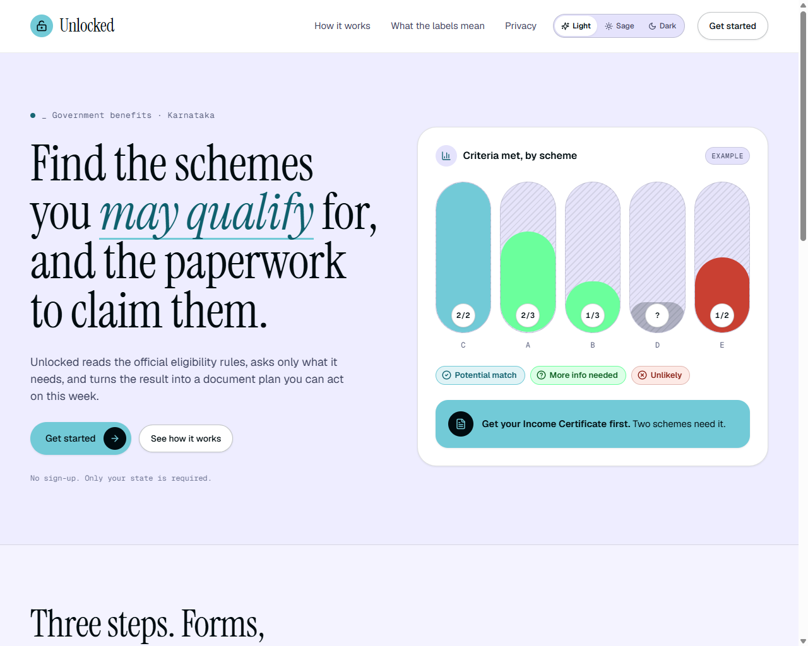
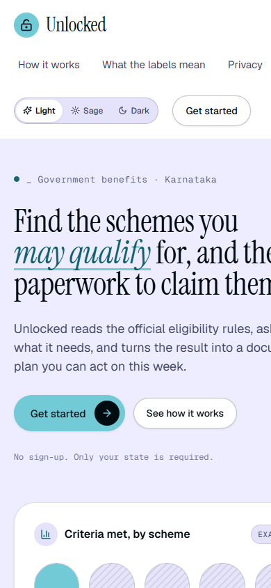
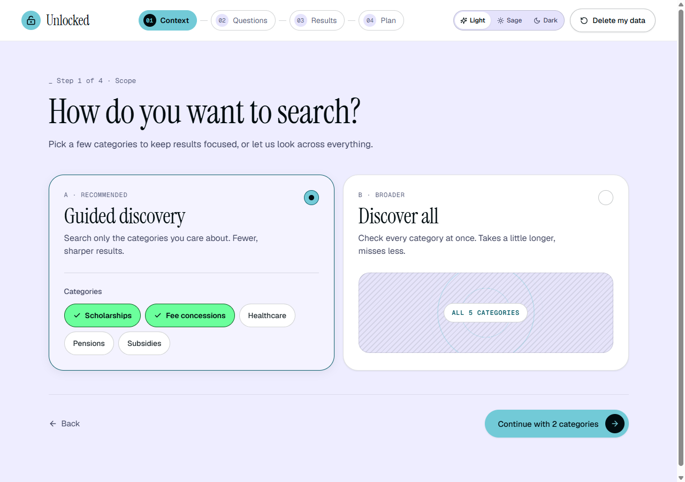
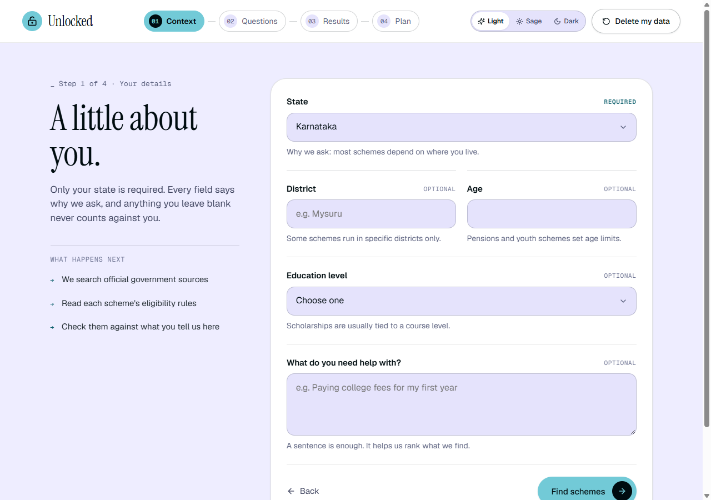
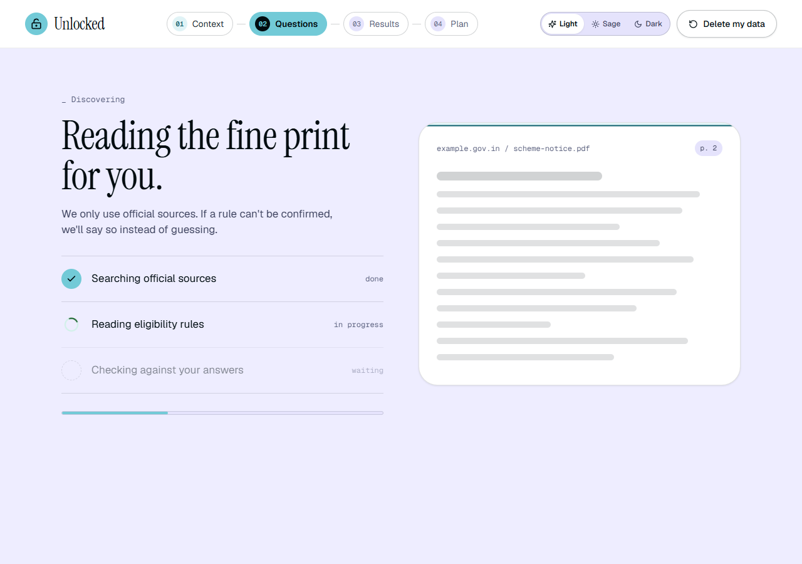
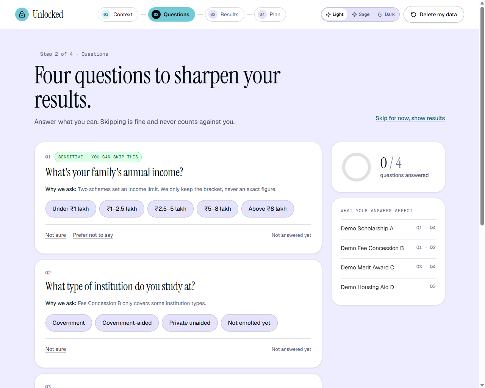
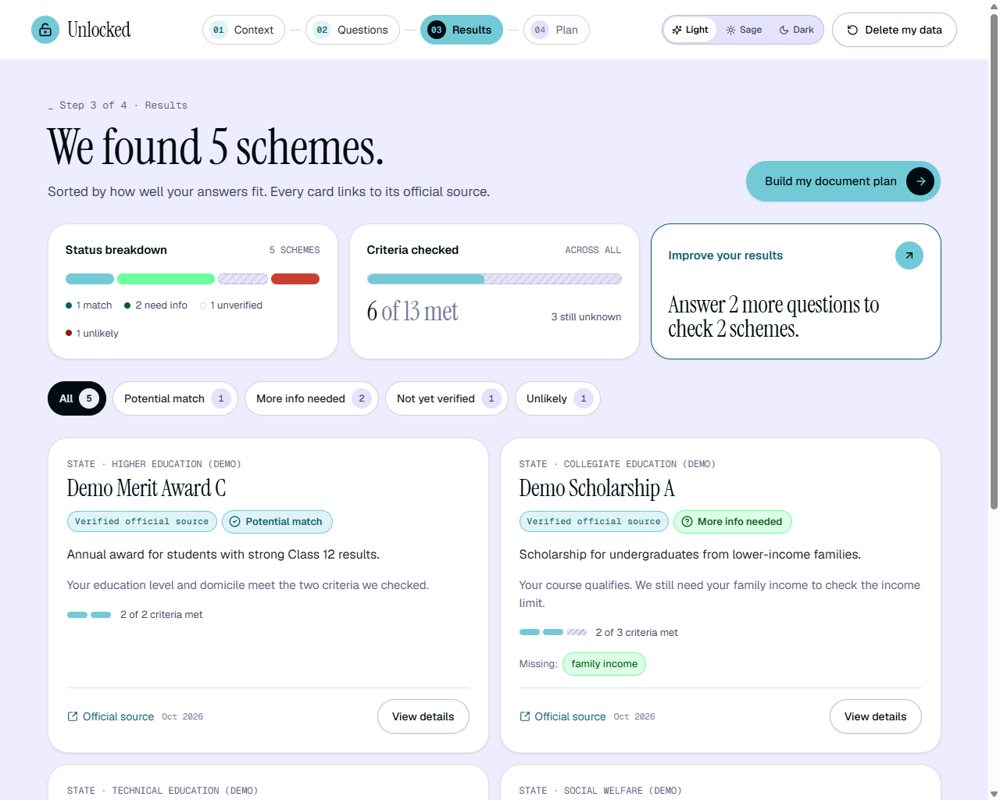
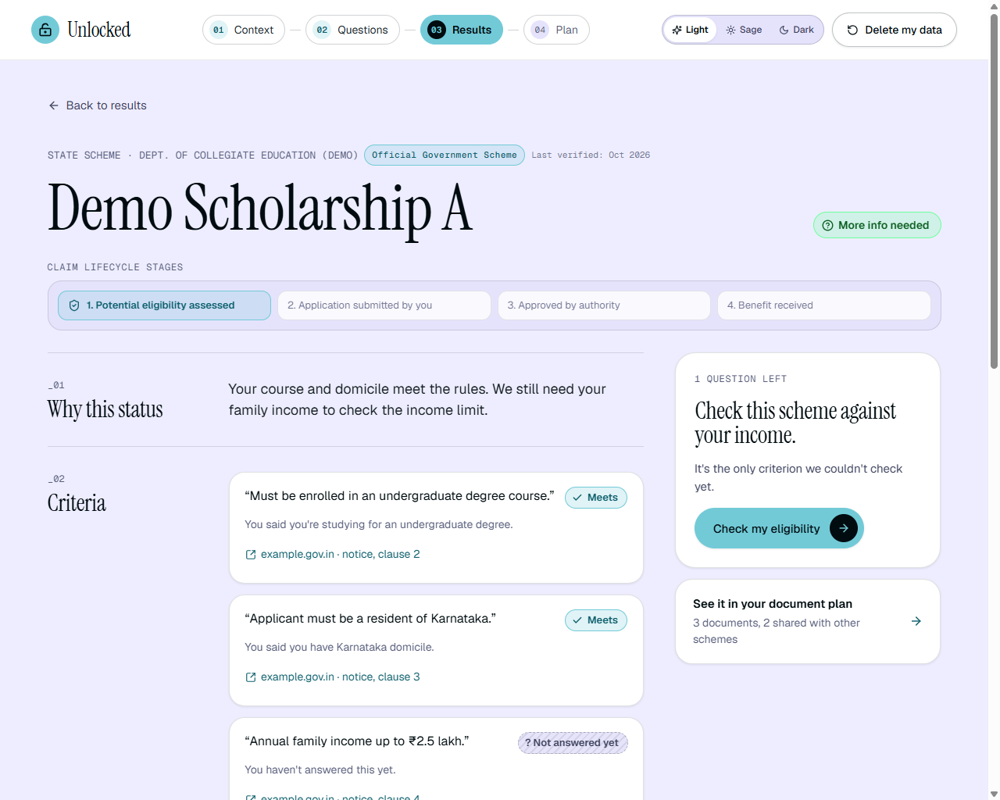
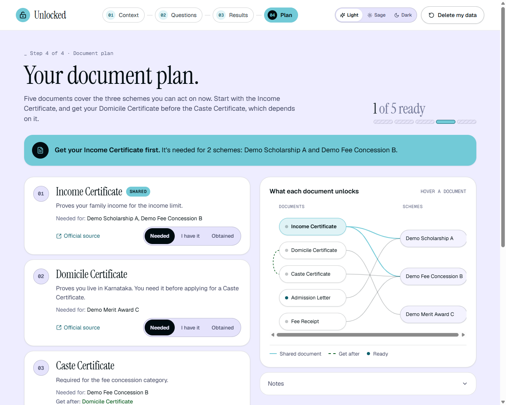
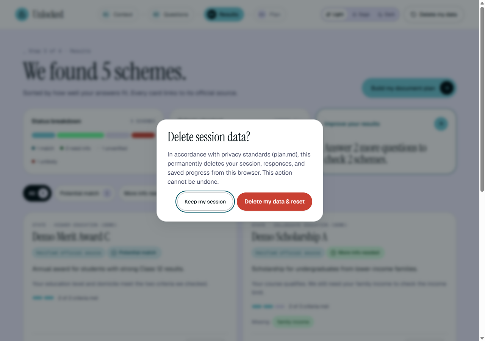

# Unlocked — Civic-Tech Scheme Discovery & Eligibility Engine

> **Unlocked** is an intelligent, privacy-preserving civic-tech platform designed for Karnataka citizens to discover public schemes, understand criteria through conservative eligibility assessments, and navigate prerequisite-aware document dependencies.

Built for the **Google Antigravity Hackathon**, Unlocked turns fragmented government portals and opaque application rules into a transparent, actionable roadmap. It strictly separates algorithmic assessment from official administrative decisions, respects user privacy without requiring Aadhaar or permanent accounts, and visualizes shared prerequisite document dependencies to prevent circular bureaucratic delays.

---

## Table of Contents

- [1. Executive Overview & Design Philosophy](#1-executive-overview--design-philosophy)
- [2. Interactive Multi-Theme Design System](#2-interactive-multi-theme-design-system)
- [3. Frontend Application Screens & User Journey](#3-frontend-application-screens--user-journey)
  - [01. Landing & Product Introduction (`/`)](#01-landing--product-introduction-)
  - [02. Discovery Mode Selection (`/start`)](#02-discovery-mode-selection-start)
  - [03. Initial Context Gathering (`/details`)](#03-initial-context-gathering-details)
  - [04. Discovery Progress & Live Scanning (`/discovering`)](#04-discovery-progress--live-scanning-discovering)
  - [05. Consolidated Multi-Scheme Questions (`/questions`)](#05-consolidated-multi-scheme-questions-questions)
  - [06. Schemes Results Dashboard (`/results`)](#06-schemes-results-dashboard-results)
  - [07. Scheme Deep Dive & Claim Lifecycle (`/scheme`)](#07-scheme-deep-dive--claim-lifecycle-scheme)
  - [08. Dependency-Aware Document Action Plan (`/plan`)](#08-dependency-aware-document-action-plan-plan)
  - [09. Privacy & Data Reset Confirmation Modal](#09-privacy--data-reset-confirmation-modal)
- [4. Implementation Alignment with `plan.md`](#4-implementation-alignment-with-planmd)
- [5. Demo Scenarios & Query Parameter Triggers](#5-demo-scenarios--query-parameter-triggers)
- [6. Technology Stack & Architecture](#6-technology-stack--architecture)
- [7. Getting Started & Local Development](#7-getting-started--local-development)

---

## 1. Executive Overview & Design Philosophy

Government portals in India (such as Seva Sindhu, departmental gazettes, and district welfare boards) often suffer from three critical user pain points:
1. **Opaque, fragmented eligibility criteria:** Citizens must guess whether they qualify across dozens of independent portals.
2. **Repetitive, intrusive questionnaires:** Citizens are asked the same demographic questions repeatedly.
3. **Circular document deadlocks:** Many schemes require documents (e.g., Caste, Income, or Domicile Certificates) that themselves depend on other preliminary certificates or affidavits, creating severe delays.

**Unlocked** addresses these challenges directly through:
- **Consolidated Questioning:** Asking a single question updates eligibility assessments across multiple schemes at once.
- **Conservative Assessments:** Unlocked *never* promises that a user is "eligible" — it indicates whether the user *"appears to meet published criteria"* versus *"needs more information"* or is *"unlikely to match"*.
- **The 4-Stage Claim Lifecycle:** Maintaining a strict distinction between *Assessed by Unlocked*, *Application Submitted*, *Authority Approved*, and *Benefit Received*.
- **Prerequisite Dependency Graphing:** Deterministic directed acyclic graph (DAG) visualization showing shared documents that unlock multiple schemes at once.
- **Zero Invasiveness:** No Aadhaar numbers, no permanent tracking, and an instant **"Delete my data"** session purge.

---

## 2. Interactive Multi-Theme Design System

Unlocked features an elegant, high-contrast, fully tokenized CSS variable architecture adhering strictly to **WCAG AA contrast ratios (4.5:1 for body text)**. Users can toggle between three tailored palettes at any point using the persistent header theme switcher:

| Theme Token Role | Light Theme (Default) | Sage Theme (Earth Calm) | Dark Theme (Civic Terminal) |
| :--- | :--- | :--- | :--- |
| **Page Background (`--bg`)** | `#eeedff` (Soft Lavender/Sky) | `#f1fbf4` (Calm Sage Mist) | `#0e0e0f` (Deep Obsidian) |
| **Surface Cards (`--surface`)** | `#ffffff` | `#ffffff` | `#161618` |
| **Primary Accent (`--primary`)** | `#3be089` (Vibrant Mint) | `#4ec768` (Leaf Green) | `#3be089` (Electric Emerald) |
| **Primary Dark Text (`--primary-dark`)** | `#00632b` (Contrast 5.4:1) | `#0a5c24` (Contrast 5.2:1) | `#3be089` |
| **Secondary Surface (`--secondary`)** | `#62ded4` (Teal Ice) | `#97dece` (Soft Celadon) | `#8b5cf6` (Civic Indigo) |
| **Secondary Dark Text (`--secondary-dark`)** | `#015b54` (Contrast 4.8:1) | `#095449` (Contrast 4.9:1) | `#c4b5fd` |
| **Warning / Unlikely (`--warn`)** | `#b53a25` (Accessible Amber Red) | `#b53a25` (Soft Terracotta) | `#f59e0b` (Warm Gold) |
| **Base Text (`--text`)** | `#040a06` (Near Pitch Black) | `#061309` (Forest Charcoal) | `#f4f4f5` (Crisp Light) |

### Contrast & Elegance Safeguards
- **No Light-on-Light Text:** Primary and secondary colors are strictly fills with high-contrast text or transformed into darkened semantic variants (`--primary-dark`, `--secondary-dark`) for readable link text and icons.
- **Accessible Muted Warm Tone:** Because civic applications require clear identification of disqualifying criteria, `--warn` utilizes a soft, non-punitive terracotta/amber (`#b53a25` / `#fdf2f0`) paired with an explicit `CircleX` icon. Status is **never communicated by color alone**.
- **Light Theme Texturing:** Replaced dark glows with crisp hairline borders (`--line: rgba(6, 19, 9, 0.08)`), subtle layered shadows (`--shadow-sm`, `--shadow-md`), and high-clarity SVG hatching.

---

## 3. Frontend Application Screens & User Journey

### 01. Landing & Product Introduction (`/`)

The front door to Unlocked sets the civic-tech tone with an editorial serif display font (*Instrument Serif*), a live preview of the criteria evaluation chart, and complete transparency regarding data handling.



- **Hero & Value Proposition:** Clear statement that Unlocked assists in navigating official Karnataka government welfare programs.
- **Criteria Distribution Preview:** An interactive summary previewing how schemes are categorized across *Potential match*, *More info needed*, *Uncertain*, and *Unlikely*.
- **"How It Works" 3-Step Walkthrough:** Guides citizens through Context $\rightarrow$ Answers $\rightarrow$ Document Checklist.
- **Status Badges Explainer:** Explicitly defines what each status means before the user begins.
- **Privacy First Section:** Three explicit promises: no permanent accounts, no Aadhaar or bank numbers collected, and full one-click session deletion.
- **Responsive Mobile Layout:** Adapts smoothly to mobile screens (390px viewport).



---

### 02. Discovery Mode Selection (`/start`)

Provides the user with clear control over the search scope and privacy boundaries before proceeding.



- **Guided Discovery (Recommended):** Prioritizes schemes matching immediate citizen needs (e.g., student scholarships, female head-of-household pensions, youth livelihoods).
- **Discover All:** Exhaustively evaluates all indexed Karnataka state and central sponsored schemes.
- **Contextual Note:** Clearly indicates estimated duration (~2–4 minutes) and that answers can be skipped at any moment.

---

### 03. Initial Context Gathering (`/details`)

Collects foundational geographic and demographic parameters required to filter schemes by jurisdiction and basic eligibility.



- **Jurisdiction Select:** State is locked to **Karnataka** for the hackathon MVP, with district dropdown (e.g., Bengaluru Urban, Mysuru, Belagavi, etc.).
- **Demographic Parameters:** Age, Education Level, and Primary Need.
- **"Why We Ask" Hints:** Every single input field features an inline, plain-language explanation of why that specific piece of data is needed for scheme filtering.
- **Sticky Form Actions:** Clear next action with visible keyboard focus and active states.

---

### 04. Discovery Progress & Live Scanning (`/discovering`)

A multi-phase, transparent animated scanner that shows real-time progress as official government gazettes, portals, and criteria databases are evaluated.



- **3-Phase Verification Sequence:**
  1. *Searching Official Portals* (Karnataka State Gazette, Seva Sindhu, DBT Karnataka).
  2. *Extracting Eligibility Rules* (Evaluating income ceilings, domicile constraints, educational thresholds).
  3. *Synthesizing Consolidated Questions* (Generating minimal question set to resolve multiple schemes).
- **Animated SVG Document Scanner:** Visualizing rule extraction over an official government scheme order mock.
- **Error & Fallback Handling:** Supports simulated network/search failure testing via the `?error=true` query parameter, offering one-click retry.

---

### 05. Consolidated Multi-Scheme Questions (`/questions`)

Rather than forcing users through separate 20-question questionnaires for each scheme, Unlocked consolidates common criteria into a single, high-leverage question stream.



- **Interactive Progress Ring:** Visualizes progress through the question set with active question indexing.
- **"Affects Multiple Schemes" Counter:** Clearly informs the citizen how many candidate schemes will be resolved or unlocked by answering this specific question.
- **Respectful & Sensitive Form Controls:**
  - Sensitive questions (such as annual family income) carry a prominent **"SENSITIVE · YOU CAN SKIP THIS"** badge.
  - Form includes distinct options for **"Prefer not to say"** and **"Not sure"**.
  - Visible, non-punitive **"Skip for now"** action that allows progressing without penalty.
- **Dynamic Live Impact Sidebar:** Shows real-time updates of which schemes change confidence as answers are selected.

---

### 06. Schemes Results Dashboard (`/results`)

The primary assessment view displaying candidate schemes ranked by criteria confidence, with clear visual proof and verification indicators.



- **Summary Header & Breakdown:** Visual progress bar illustrating the distribution of schemes across Potential Match, More Info Needed, and Unlikely.
- **Filter Chips:** Instant filtering across *All Schemes*, *Potential match*, *More info needed*, *Not yet verified*, and *Unlikely to match*.
- **Criteria Met Pips:** Visual mini-indicators displaying how many published criteria are satisfied versus pending.
- **Outcome Provenance Badges:**
  - `Verified official source` (with direct link to Karnataka Government portal).
  - `Fallback · Demo data` (transparently flagging simulated or unverified demo schemes).
- **Official Source Metadata:** Shows the exact official department URL and the **"Last verified: Oct 2026"** audit date.
- **Limited Results Banner:** Gracefully displays guidance when search filters yield constrained results (`?limited=true`).

---

### 07. Scheme Deep Dive & Claim Lifecycle (`/scheme`)

An exhaustive, transparent breakdown of a single scheme's published rules, required paperwork, and application path.



- **Conservative Assessment Disclaimer:** Prominently displays: *"Assessment, not an official decision. Authorities decide eligibility."*
- **The 4-Stage Claim Lifecycle Tracker (Plan.md §2.6):**
  1. **Assessed by Unlocked** *(Current)* — Algorithm checked published criteria.
  2. **Application Submitted** *(Pending)* — Citizen files on official portal.
  3. **Authority Approved** *(Pending)* — Government verification and sanction.
  4. **Benefit Received** *(Pending)* — Direct Bank Transfer (DBT) credit or card dispatch.
- **Criteria Verification Matrix:** Itemized list of all criteria categorized into *Satisfied*, *Pending answer*, or *Not met*.
- **Inline "Check My Eligibility":** Allows citizens to answer scheme-specific questions without leaving the page.
- **Required Documents & Application Steps:** Concrete, step-by-step guidance on how and where to apply (e.g., Seva Sindhu or Grama One counters).

---

### 08. Dependency-Aware Document Action Plan (`/plan`)

A directed acyclic dependency plan that identifies common prerequisite documents and sequences application steps to prevent bureaucratic deadlocks.



- **Interactive SVG Prerequisite Graph:** Visual representation connecting foundational identity documents to intermediate certificates and final scheme applications.
- **Shared Prerequisite Badges (`SHARED`):** Highlights foundational documents (such as the *Income Certificate* or *Ration Card*) that unlock multiple target schemes at once.
- **"Get After" Dependency Sequencing:** Explicitly indicates prerequisites (e.g., *"Get after obtaining Income Certificate & Ration Card"*).
- **Status Tracking Controls:** Citizens can mark documents as *Needed*, *I have it*, or *Obtained*, recalculating remaining friction.
- **Direct Official Portal Links:** Links to Sakala / Seva Sindhu for issuing authority portals.

---

### 09. Privacy & Data Reset Confirmation Modal

A secure, accessible confirmation dialog verifying user intent when clearing session data.



- **Accessible Focus Trap:** Automatically traps keyboard focus and supports `Esc` key dismissal.
- **Complete In-Memory Purge:** Clicking "Yes, delete everything" immediately wipes all demographic answers, scheme states, and document checklists, returning to `/`.

---

## 4. Implementation Alignment with `plan.md`

The table below tracks the complete implementation status against the specifications laid out in `plan.md`:

| Plan.md Section | Requirement / Guideline | Frontend Implementation Status | File / Component Reference |
| :--- | :--- | :--- | :--- |
| **§2.1 Start & Context** | State, District, Age, Education, Need with plain-language hints | ✅ Fully Implemented | `src/pages/Details.tsx` |
| **§2.1 Discovery Modes** | Guided Discovery vs. Discover All selection | ✅ Fully Implemented | `src/pages/Start.tsx` |
| **§2.2 Live Discovery** | 3-phase loading animation, simulated scan, error recovery | ✅ Fully Implemented | `src/pages/Discovering.tsx` |
| **§2.3 Consolidated Qs** | Multi-scheme question batching, progress tracker | ✅ Fully Implemented | `src/pages/Questions.tsx` |
| **§2.3 User Respect** | "Skip for now", "Not sure", and "Prefer not to say" options | ✅ Fully Implemented | `src/pages/Questions.tsx` (`RadioGroup`) |
| **§2.3 Sensitivity Notice**| Explicit "SENSITIVE · YOU CAN SKIP THIS" label on income | ✅ Fully Implemented | `src/pages/Questions.tsx` |
| **§2.4 Scheme Results** | Potential match / More info / Uncertain / Unlikely | ✅ Fully Implemented | `src/ui.tsx` (`BADGES`, `StatusBadge`) |
| **§2.4 Conservative Copy** | Never call user "eligible"; use "appears to meet criteria" | ✅ Fully Implemented | `src/pages/Results.tsx`, `src/pages/Scheme.tsx` |
| **§2.4 Provenance Badges** | Verified official source vs. Fallback · Demo data badges | ✅ Fully Implemented | `src/ui.tsx` (`OutcomeSourceBadge`) |
| **§2.4 Verification Dates** | "Last verified: [Date]" timestamps on scheme cards | ✅ Fully Implemented | `src/pages/Results.tsx`, `src/data.ts` |
| **§2.5 Document Checklist**| Combined document requirements, status tracking | ✅ Fully Implemented | `src/pages/Plan.tsx` |
| **§2.5 Shared Prerequisites**| `SHARED` pills for documents unlocking $\ge 2$ schemes | ✅ Fully Implemented | `src/pages/Plan.tsx` |
| **§2.5 Dependency Graph** | SVG DAG visualization connecting prerequisites to schemes | ✅ Fully Implemented | `src/pages/Plan.tsx` |
| **§2.5 "Get After" Flow** | Explicit ordering of prerequisite certificates | ✅ Fully Implemented | `src/pages/Plan.tsx` |
| **§2.6 Claim Lifecycle** | 4 separate stages: Assessed $\rightarrow$ Submitted $\rightarrow$ Approved $\rightarrow$ Received | ✅ Fully Implemented | `src/pages/Scheme.tsx` (`.claim-lifecycle`) |
| **§2.6 Disclaimer** | "Assessment, not an official decision. Authorities decide." | ✅ Fully Implemented | `src/ui.tsx` (`Disclaimer`) |
| **§5 Shared Contracts** | Normalized TypeScript schema for Schemes, Qs, Assessments | ✅ Fully Implemented | `src/data.ts` |
| **§11 Privacy & Consent** | No Aadhaar, no permanent accounts, session-only storage | ✅ Fully Implemented | `src/session.tsx`, `src/pages/Landing.tsx` |
| **§11 "Delete My Data"** | Dedicated header button with accessible confirmation dialog | ✅ Fully Implemented | `src/ui.tsx` (`StartOverDialog`) |
| **§12 Error States** | Handled search failures, empty states, and limited results | ✅ Fully Implemented | `src/pages/Discovering.tsx`, `src/pages/Results.tsx` |
| **WCAG Accessibility** | Color + Icon + Text for all badges; full keyboard support | ✅ Fully Implemented | `src/styles.css`, `src/ui.tsx` |

---

## 5. Demo Scenarios & Query Parameter Triggers

To facilitate testing and judge presentations, Unlocked includes built-in scenario triggers via URL search parameters:

- **Switch Themes on the Fly:**
  - `http://localhost:5173/?theme=light` — Activates the default Light Lavender/Mint theme.
  - `http://localhost:5173/?theme=sage` — Activates the Earthy Sage Green theme.
  - `http://localhost:5173/?theme=dark` — Activates the High-Contrast Dark theme.
- **Simulate Network / Discovery Error:**
  - `http://localhost:5173/discovering?error=true` — Triggers the simulated portal timeout / search failure state with retry button.
- **Simulate Constrained Search Results:**
  - `http://localhost:5173/results?limited=true` — Renders the limited criteria match banner with guidance on relaxing filters.
- **Test Delete Data Modal:**
  - Clicking **"Delete my data"** in the top navigation header opens the accessible focus-trapped confirmation modal.

---

## 6. Technology Stack & Architecture

- **Core Framework:** React 18 with TypeScript 5
- **Bundler & Tooling:** Vite 6
- **Routing Engine:** Zero-dependency custom browser history router (`src/router.tsx`) supporting pushState navigation and clean URLs.
- **Styling Architecture:** Pure semantic CSS Custom Properties (`src/styles.css`). Zero Tailwind runtime overhead; instant paint times and 100% predictable theme token cascading.
- **Iconography:** `lucide-react` (SVGs configured with `aria-hidden` and explicit accessible labels).
- **Typography:**
  - Headings: *Instrument Serif* (Classic civic authority and human-centered editorial elegance).
  - Body & UI: *Geist Sans* (Clean, legible, modern grotesk).
  - Code & Metadata: *Geist Mono* (High-clarity numeric alignment).

---

## 7. Getting Started & Local Development

### Prerequisites
- Node.js (v18.0.0 or higher recommended)
- npm or pnpm

### Quick Setup

```bash
# 1. Navigate to the project directory
cd frontendagentathon

# 2. Install dependencies
npm install

# 3. Start the local Vite development server
npm run dev
```

The application will be live at `http://localhost:5173`.

### Production Build & Typecheck

```bash
# Verify TypeScript types and compile production bundle
npm run build

# Preview the production build locally
npm run preview
```

---

*Crafted with care for Karnataka citizens — empowering communities with transparent, reliable access to public welfare.*


## 8. Connecting to the backend

The app talks to the FastAPI service in `api/` (see `src/api.ts`). With no backend running it falls back to its built-in demo data, so it always works.

```bash
# terminal 1, from the repo root (no API keys needed: it serves its offline fallback schemes)
python -m uvicorn api.main:app --port 8000

# terminal 2
cd frontendagentathon
npm install
npm run dev          # http://localhost:5173
```

- `VITE_API_URL` (see `.env.example`) points the app at another backend. The default is `http://127.0.0.1:8000`.
- The flow: Context form -> `POST /api/sessions` -> `POST /discover` -> results (`/schemes`) -> questions (`/questions`, `/answers`) -> plan (`/plan`, `/checklist/{doc}`) -> actions (`/actions/email`, `/actions/calendar`, `/progress`).
- Without `GEMINI_API_KEY` and `TAVILY_API_KEY` the backend returns only its verified-offline fallback schemes (rules unverified, so no questions). Add the keys to `.env` for live search and AI-assisted drafts.
- `npm test` runs unit and page-flow tests. `src/real-backend.test.tsx` runs the whole journey against a running backend and skips itself when none is listening.
