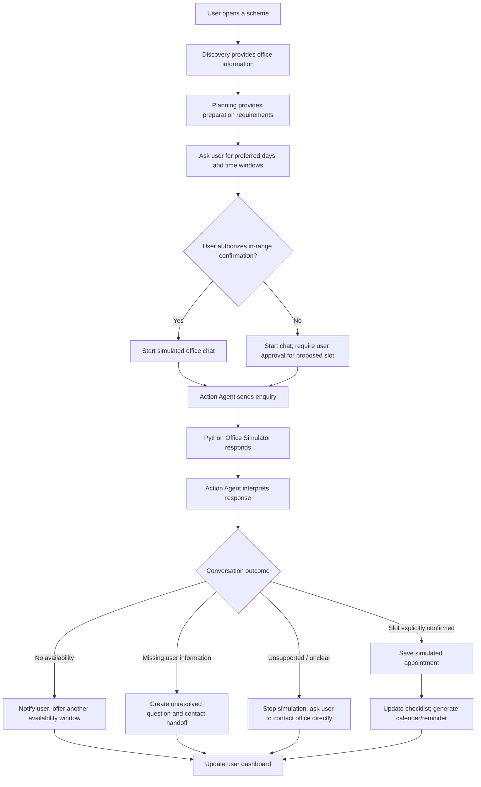

# Unlocked Feature Specification: Office Chat Simulator

**Status:** Proposed hackathon implementation specification  
**Priority:** P0/P1 integration feature (see prioritisation below)  
**Owner:** Member 1 (Discovery + Action Agents), Member 3 (Backend), Member 4 (Frontend); Member 2 supplies verified scheme and document information  
**Replaces:** The previously proposed browser-based voice/call simulator  
**Important:** This feature is an in-website simulation. It is **not** a real WhatsApp integration and does not contact a government office.

---

## 1. Purpose

Unlocked will provide a WhatsApp-style **Office Chat Simulator** where its Action & Follow-through Agent can demonstrate how it would communicate with a relevant office to enquire about an appointment, negotiate a time within the user's preferences, answer questions using verified scheme information, and hand unresolved questions back to the user.

The simulated conversation takes place entirely inside the Unlocked website. A controlled Python office simulator acts as the representative. The existing Action Agent drives the conversation and decides what to ask or do next.

The feature should demonstrate meaningful actions, not just display a prerecorded chat transcript. It must support multiple turns, conditional responses, appointment outcomes, unresolved questions, and updates to the user's action plan.

### 1.1 Goals

1. Enrich discovered scheme/office records with office contact details and published office hours when available.
2. Collect the user's preferred appointment days and time windows before starting an enquiry.
3. Prepare an enquiry using only information that the user has approved for the purpose.
4. Run a multi-turn WhatsApp-like conversation between the Action Agent and a simulated office representative.
5. Handle successful appointment offers, no availability, requests for missing information, and unsupported/unclear enquiries.
6. Capture receiver-provided WhatsApp contact details when further information must be supplied by the user.
7. Prepare a user-controlled WhatsApp or email follow-up draft.
8. Persist the conversation and its outcome, and connect applicable outcomes to the existing calendar and Resend notification workflow.

### 1.2 Non-goals

Do **not** implement the following for this hackathon feature:

- Real WhatsApp Business API integration.
- Actual messages sent to a government office.
- Actual telephone calls, voice recording, speech-to-text, or text-to-speech.
- Real appointment inventory or live slot availability integration.
- Automatic submission of applications, forms, or documents.
- Automatic sending of WhatsApp messages to a receiver.
- A fifth autonomous agent.

The UI must visibly label the conversation and its outcomes as simulated. Never imply that an actual government office was contacted or that an actual appointment was booked.

---

## 2. Product flow

The feature starts only after the user has selected a relevant scheme and Unlocked has determined that an office enquiry or appointment could be useful.

1. **Office enrichment:** Discovery Agent returns available office hours, WhatsApp number, email address, reception number, office name/address, and source metadata.
2. **Preparation:** Planning Agent supplies relevant document requirements and preparation steps. Eligibility Agent supplies verified scheme facts that may be needed to answer representative questions.
3. **User availability:** Unlocked asks the user which days and time windows work for them.
4. **Authorization:** Unlocked explains that the next step is a simulated enquiry and asks the user to authorize the Action Agent to accept an appointment that falls within their chosen availability. If they do not pre-authorize, the proposed slot must be presented for user approval.
5. **Conversation:** Action Agent sends messages to the simulated representative. The representative responds according to the selected scenario and current conversation state.
6. **Resolution:** Action Agent identifies the outcome: a slot was explicitly confirmed in the simulation, no slots were available, more information is required from the user, or the enquiry could not be resolved.
7. **Follow-through:** Update the session, appointment state, checklist, unresolved-question queue, and relevant notification/reminder workflow.

### 2.1 High-level flow



---

## 3. Office information collected by Discovery Agent

The Discovery Agent should extract the following fields when they are available from the scheme page or relevant office/department website.

| Field | Required? | Description |
|---|---|---|
| `office_name` | Optional | Name of the relevant office or department |
| `office_address` | Optional | Office address/location |
| `office_hours` | Optional | Published operating hours, including days where available |
| `whatsapp_number` | Optional | WhatsApp number found on a website or supplied during the simulated enquiry |
| `email` | Optional | Office email address |
| `reception_number` | Optional | Main/reception telephone number |
| `source_url` | Optional | Page from which the office information was extracted |
| `last_checked` | Optional | Date/time the information was checked |
| `contact_source` | Optional | `website`, `receiver_provided`, or `user_provided` |
| `verification_status` | Required for populated contact data | `verified`, `unverified`, or `uncertain` |

Illustrative structure:

```json
{
  "office_contact": {
    "office_name": null,
    "office_address": null,
    "office_hours": {
      "monday": {"open": "10:00", "close": "17:00"},
      "tuesday": {"open": "10:00", "close": "17:00"},
      "timezone": "Asia/Kolkata"
    },
    "whatsapp_number": null,
    "email": null,
    "reception_number": null,
    "source_url": null,
    "last_checked": null,
    "contact_source": "website",
    "verification_status": "unverified"
  }
}
```

The example values are placeholders, not actual office information.

### 3.1 Hackathon scheduling simplification

For the hackathon simulation, **treat published office hours as the window in which the simulator may offer appointment times**. Do not build a separate appointment-capacity or live-slot inventory system.

This is a simplifying simulation assumption only. In the real world, office opening hours do not prove that an appointment is available. The simulated representative's response is what determines whether a slot is offered or unavailable.

If office hours are missing, do not invent them. The UI should say that hours were not found and either ask the user to provide a preferred enquiry window or use a clearly labelled demo fixture.

### 3.2 Targeted enrichment

Do not perform extensive office research for every discovered scheme. Initially preserve any contact information returned during scheme discovery. When the user selects a scheme and an appointment/enquiry becomes relevant, perform targeted enrichment for the appropriate district/office if the Discovery implementation supports it.

---

## 4. User availability and authorization

Before the conversation starts, collect availability for the specific office enquiry.

### 4.1 Suggested user inputs

- Preferred days (e.g. Monday, Tuesday, Wednesday).
- Preferred time windows (e.g. morning, afternoon, any time within office hours).
- Optional date range, if the team has time to implement it.
- Preferred office/location, if more than one office is listed.
- Whether the user authorizes the Action Agent to accept an appointment within the selected window.

Do not require a single exact time. Store a set of acceptable windows.

Illustrative request:

```json
{
  "scheme_id": "scheme_001",
  "preferred_days": ["monday", "tuesday"],
  "preferred_windows": [
    {"start": "09:00", "end": "12:00"}
  ],
  "date_range_start": null,
  "date_range_end": null,
  "office_id": "office_001",
  "pre_authorized_confirmation": true
}
```

### 4.2 Matching rules

For the hackathon, a simulated offered slot is acceptable only when:

1. The date/day is within the user's selected availability.
2. The time is within the user's selected time window.
3. The time falls within the published office-hour window used by the simulation.
4. The simulated representative explicitly offers that slot.
5. If `pre_authorized_confirmation` is true, the user has already authorized the Action Agent to accept an in-range slot. If false, the user must approve the offered slot before the system marks it confirmed.

A matching window is not by itself an appointment. Do not change the status to confirmed until the simulated representative explicitly confirms the specific date and time.

### 4.3 Authorization copy

Suggested UI wording:

> I authorize Unlocked to accept an appointment if the simulated office representative explicitly confirms a slot within the days and times I selected. I understand this is a demonstration and does not book a real appointment.

If pre-authorization is not granted, the Action Agent can negotiate and receive a proposed slot, but must pause for user approval before confirming it in the simulation.

---

## 5. Simulated WhatsApp interface

### 5.1 UI requirements

Build a dedicated screen or panel that resembles a messaging application without copying WhatsApp branding in a way that suggests an official integration.

Suggested title: **Office Communication Simulator**.

The page must display a persistent `SIMULATION` label.

Required UI elements:

- Office name and scheme name.
- Conversation status (e.g. `In progress`, `Appointment offered`, `Simulated appointment confirmed`, `No availability`, `Awaiting user`, `Unable to resolve`).
- Outgoing messages from `Unlocked Assistant`.
- Incoming messages from `Simulated Office Representative`.
- Message timestamps/turn order.
- A conversation progress indicator.
- Appointment details panel when a date/time has been offered or confirmed.
- Unresolved questions panel when the representative needs information from the user.
- Receiver-provided WhatsApp number, if supplied in the scenario.
- Final outcome and next steps.
- A demo-only scenario selector or reset control.

The user does not need to type every Action Agent message. The Action Agent should drive the simulated enquiry after the user has approved the availability and context. The user can be asked for information if the representative raises a question the agent cannot answer.

### 5.2 Conversation presentation

Use visually distinct message bubbles:

- `Unlocked Assistant` — outgoing bubble.
- `Simulated Office Representative` — incoming bubble.

Do not display the simulated representative as a real person or as a real government account. Clearly identify the environment as a simulation in the chat header and final result.

---

## 6. Office simulator design

Use a **controlled Python scenario engine** for the representative. Do not rely on a second unrestricted LLM to invent office policies, contact details, appointment inventory, or confirmations.

The simulator should be deterministic for the main demo scenarios. It may optionally vary harmless wording, but scenario facts and outcomes must come from fixed fixture data.

### 6.1 Required scenarios

#### Scenario A — Successful appointment

- User has selected preferred days and time windows.
- Simulated representative offers a time inside the user's allowed window and office hours.
- Action Agent asks the representative to confirm the exact date and time.
- Representative explicitly confirms.
- If pre-authorization exists, Action Agent accepts; otherwise it pauses for user approval.
- Save status as `simulated_confirmed`, not `confirmed` or `real_booking_confirmed`.
- Update the simulated appointment details and show the next steps.

#### Scenario B — No availability

- Representative says no appointments are available in the user's selected window.
- Action Agent must not invent another slot.
- Save status as `no_availability`.
- Notify the user and offer to collect a different availability window or use another official route.
- Do not create a confirmed calendar appointment.

#### Scenario C — Representative requests missing information

- Representative asks for information that is not present in the approved call/enquiry context or verified scheme data.
- Action Agent must not guess or disclose unrelated personal information.
- It should say that the applicant will provide the information directly.
- The simulator may provide a WhatsApp number for the applicant to use.
- Store that number as `receiver_provided`, not as independently verified.
- Create an `UnresolvedQuestion` for the user.
- Generate a WhatsApp message draft and, if a number is present, offer a user-controlled `wa.me` link.
- The user reviews and sends the message. Unlocked does not automatically send it.

#### Scenario D — Unsupported or unclear enquiry

- Representative says the matter cannot be handled through this channel, gives an ambiguous response, or the conversation reaches a state the Action Agent cannot safely interpret.
- Action Agent should stop rather than fabricate a resolution.
- Save status as `manual_followup_required` or `unable_to_resolve`.
- Tell the user that the enquiry could not be resolved through the simulation and recommend contacting the office directly using the available contact information.
- Do not create an appointment or send a confirmation reminder.

### 6.2 Additional response handling

The simulator and Action Agent should handle:

- A slot that does not match the user's availability.
- A request for a different day/time.
- A request for a document requirement.
- A question whose answer exists in verified scheme information.
- A question whose answer is unknown or unverified.
- A request for a WhatsApp number or email for user follow-up.
- A representative who cannot confirm the proposed slot.
- Repeated or contradictory responses.

### 6.3 Scenario data

Keep scenario fixtures separate from production code, for example:

```text
backend/
  app/
    services/
      office_simulator.py
    agents/
      action.py
  fixtures/
    office_chat_scenarios.json
```

Example scenario configuration:

```json
{
  "scenario_id": "success_monday_11",
  "scenario_type": "successful_appointment",
  "office_id": "demo_office_001",
  "responses": [
    {
      "trigger": "initial_enquiry",
      "message": "We have an appointment available Monday at 11:00 AM."
    },
    {
      "trigger": "confirm_slot",
      "message": "Yes, Monday at 11:00 AM is confirmed for this simulated enquiry."
    }
  ]
}
```

All fixture text must be treated as simulated dialogue, not official office guidance.

---

## 7. Action Agent responsibilities

The existing Action & Follow-through Agent owns the conversation. Do not create a separate Office Agent.

### 7.1 Before the chat

- Receive the selected scheme, office details, user availability, and relevant document requirements.
- Build a concise enquiry context.
- Use only verified scheme facts for answers.
- Do not include the user's full profile or sensitive attributes in outgoing messages.
- Ask for user approval of the context/availability and booking authorization.

### 7.2 During the chat

- Initiate the enquiry.
- Ask about an appointment within the user's availability.
- Understand the representative's responses.
- Ask follow-up questions where needed.
- Answer only from verified scheme information or the approved context.
- If the answer is unknown, say so and create an unresolved question.
- Never fabricate an office policy, document requirement, appointment slot, deadline, contact number, or confirmation.
- Stop the conversation when the scenario is unsupported or cannot be safely interpreted.

### 7.3 After the chat

- Return a structured outcome.
- Persist the transcript and appointment state.
- Update the document/action checklist where appropriate.
- Create an unresolved question if user input is needed.
- Generate a WhatsApp/email draft for the user to review and send.
- Create a calendar event only for a `simulated_confirmed` appointment, clearly labelled as simulated in demo mode.
- Trigger a Resend notification only when the user has opted in and the environment is configured to send to an allowed test/real recipient.

### 7.4 Suggested structured Action Agent output

```json
{
  "assistant_message": "Could you please confirm Monday at 11:00 AM?",
  "conversation_status": "ongoing",
  "next_action": "request_slot_confirmation",
  "appointment_offer": {
    "date": "2026-11-02",
    "time": "11:00",
    "status": "offered"
  },
  "unresolved_questions": [],
  "contact_handoff": null,
  "outcome": null
}
```

Validate all model outputs with Pydantic before updating state or triggering actions.

---

## 8. User information and contact handoff

### 8.1 Do not disclose user information directly

For this hackathon feature, the Action Agent must not send the user's personal profile, identity details, income/caste information, or documents to the simulated representative.

The initial enquiry should contain only:

- The scheme being discussed.
- The general purpose of the enquiry.
- The requested appointment type.
- User-approved availability.
- General document/requirement questions that do not identify the user.

If the representative asks for personal information, the Action Agent should say that the applicant will provide it directly.

### 8.2 Receiver-provided WhatsApp number

If the simulated representative provides a WhatsApp number for follow-up:

1. Capture the number.
2. Normalize it to a consistent international format where possible.
3. Display it back to the user for review.
4. Store its origin as `receiver_provided`.
5. Do not describe it as independently verified.
6. Generate a message draft using only the unresolved question and relevant scheme context.
7. Let the user open WhatsApp with the message prefilled or copy the message.
8. The user reviews and sends it manually.

If no WhatsApp number is provided, use an available email address, copyable message, or official contact details to guide the user to contact the office themselves.

### 8.3 Click-to-chat handoff

When a number is available and the user chooses WhatsApp follow-up, generate a standard Click to Chat URL:

```text
https://wa.me/<international_number>?text=<url_encoded_message>
```

Requirements:

- Do not include `+`, spaces, brackets, or dashes in the phone-number path.
- URL-encode the prefilled message.
- Do not open the URL automatically; the user clicks it.
- Do not claim the message was sent. Opening the link only opens a prepared conversation.
- The user must review and press Send in WhatsApp.

Suggested message:

> Hello, I am following up regarding an enquiry about [scheme/office]. I was asked to clarify [unresolved question]. Could you please confirm the relevant information and any applicable instructions? Thank you.

The message must be editable. Do not insert sensitive personal information automatically.

---

## 9. Outcomes and state model

Keep chat state separate from appointment state.

### 9.1 Chat statuses

Recommended values:

- `created`
- `in_progress`
- `awaiting_user_input`
- `appointment_offered`
- `completed`
- `no_availability`
- `manual_followup_required`
- `unable_to_resolve`
- `cancelled`

### 9.2 Appointment statuses

Recommended values:

- `not_requested`
- `requested`
- `offered`
- `awaiting_user_approval`
- `simulated_confirmed`
- `no_availability`
- `cancelled`

Do not use `real_booking_confirmed` for this feature.

### 9.3 Unresolved-question statuses

- `open`
- `shown_to_user`
- `draft_prepared`
- `user_marked_sent`
- `resolved`
- `dismissed`

`user_marked_sent` is user-reported; it is not proof that the receiver received or answered the message.

### 9.4 Outcome actions

| Outcome | Required system action |
|---|---|
| `simulated_confirmed` | Save simulated appointment, update dashboard, optionally generate simulated calendar event and opted-in demo email |
| `no_availability` | Inform user; invite new availability or an alternative official route; no appointment event |
| `awaiting_user_input` | Save unresolved question; show it to the user; prepare WhatsApp/email draft when possible |
| `manual_followup_required` | Show available contact information and recommend direct user contact |
| `unable_to_resolve` | Stop the simulation, explain the limitation, and recommend direct contact |
| `cancelled` | Save cancellation and stop further actions |

---

## 10. Persistence and suggested data models

Use the existing SQLite session system. Add focused tables or equivalent validated JSON records without redesigning the entire database.

### 10.1 Suggested entities

#### `OfficeContact`

- `office_id`
- `scheme_id`
- `office_name`
- `office_address`
- `office_hours_json`
- `whatsapp_number`
- `email`
- `reception_number`
- `source_url`
- `contact_source`
- `verification_status`
- `last_checked`

#### `AppointmentPreferences`

- `preference_id`
- `session_id`
- `scheme_id`
- `office_id`
- `preferred_days_json`
- `preferred_windows_json`
- `date_range_start`
- `date_range_end`
- `pre_authorized_confirmation`
- `created_at`

#### `OfficeChatSession`

- `chat_id`
- `session_id`
- `scheme_id`
- `office_id`
- `scenario_id`
- `simulation_mode` (must be true for this feature)
- `chat_status`
- `appointment_status`
- `appointment_json`
- `started_at`
- `completed_at`

#### `OfficeChatMessage`

- `message_id`
- `chat_id`
- `sender` (`unlocked` or `simulated_office`)
- `message_text`
- `turn_index`
- `created_at`
- `metadata_json`

#### `UnresolvedQuestion`

- `question_id`
- `chat_id`
- `session_id`
- `question_text`
- `context_json`
- `receiver_whatsapp_number`
- `contact_source` (`receiver_provided`, `website`, `user_provided`)
- `status`
- `draft_message`
- `created_at`

Use migrations or safe table creation consistent with the existing backend conventions. Avoid storing unnecessary personal information.

---

## 11. Suggested API endpoints

All stored-data routes must be session-scoped or validate the session ID through the chat record.

| Method | Endpoint | Purpose |
|---|---|---|
| `POST` | `/api/sessions/{session_id}/office-chats` | Create a simulated office chat with scheme, office, availability and scenario |
| `GET` | `/api/office-chats/{chat_id}` | Retrieve chat, messages and current state |
| `POST` | `/api/office-chats/{chat_id}/advance` | Run the next Action Agent/simulator turn |
| `POST` | `/api/office-chats/{chat_id}/user-input` | Supply missing information or approve a proposed slot |
| `POST` | `/api/office-chats/{chat_id}/finish` | Finish/stop the conversation |
| `GET` | `/api/office-chats/{chat_id}/outcome` | Retrieve final appointment and follow-up outcome |
| `GET` | `/api/sessions/{session_id}/unresolved-questions` | List outstanding questions |
| `POST` | `/api/unresolved-questions/{question_id}/draft` | Generate or regenerate a follow-up draft |
| `POST` | `/api/unresolved-questions/{question_id}/mark-sent` | Record that the user says they sent the message |

The `scenario_id` selector should be available only in demo/test mode. Do not expose arbitrary scenario selection as a production capability.

### 11.1 Create-chat request example

```json
{
  "scheme_id": "scheme_001",
  "office_id": "office_001",
  "scenario_id": "success_monday_11",
  "availability": {
    "preferred_days": ["monday", "tuesday"],
    "preferred_windows": [
      {"start": "09:00", "end": "12:00"}
    ]
  },
  "pre_authorized_confirmation": true
}
```

### 11.2 Advance response example

```json
{
  "chat_id": "chat_demo_001",
  "simulation_mode": true,
  "chat_status": "appointment_offered",
  "messages": [
    {
      "sender": "unlocked",
      "text": "Could you tell us whether a document-verification appointment is available Monday morning?"
    },
    {
      "sender": "simulated_office",
      "text": "We can offer Monday at 11:00 AM."
    }
  ],
  "appointment": {
    "date": "2026-11-02",
    "time": "11:00",
    "status": "offered"
  },
  "next_action": "request_explicit_confirmation"
}
```

These examples are illustrative contracts, not actual appointment data.

---

## 12. Agent and member responsibilities

Do not add a fifth agent. Extend the existing four logical stages.

| Member/agent | Responsibility for this feature |
|---|---|
| **Member 1 — Discovery + Action** | Extend Discovery output with office information; implement Action Agent conversation prompts, question handling, appointment negotiation, and structured outcomes |
| **Member 2 — Eligibility + Planning** | Provide verified scheme answers, document requirements, preparation steps, and relevant dependencies to the Action Agent |
| **Member 3 — Backend/technical lead** | Implement chat orchestration, Python simulator, API routes, SQLite persistence, session validation, and integration with calendar/Resend workflows |
| **Member 4 — Frontend** | Build the WhatsApp-style Office Communication Simulator UI, message bubbles, status panel, availability inputs, unresolved-question view, and user-controlled follow-up controls |

### 12.1 Integration boundaries

- Member 1 must expose an Action Agent function that accepts conversation history, verified scheme context, office contact context, user availability, authorization, and simulator response.
- Member 2 must expose verified requirements and document information in the shared schema.
- Member 3 owns the simulator and state transitions. The Action Agent must not directly modify SQLite or call arbitrary APIs.
- Member 4 consumes structured API responses and must not hardcode the outcomes of the four scenarios in the frontend.

---

## 13. Calendar and Resend integration

Reuse the existing follow-through feature plan and notification implementation.

### 13.1 Calendar

- Generate an `.ics` event only after the simulator reaches `simulated_confirmed`.
- Clearly label the event title/description as a **simulated appointment**.
- Include office name/address and preparation checklist only when those values are available.
- Do not create an appointment event for an offered-but-unconfirmed slot or a no-availability result.

### 13.2 Resend email

- Respect the existing user email opt-in and consent state.
- In demo mode, restrict actual email delivery to configured test recipients/allowlists.
- Email content must clearly state that the appointment was simulated and is not a real booking.
- Do not send emails merely because a chat was opened.
- Record provider status accurately; an API acceptance is not proof of inbox delivery.

### 13.3 WhatsApp handoff

- The simulator itself is not WhatsApp.
- A receiver-provided number can be used to prepare a user-controlled Click to Chat link.
- The app must not send messages automatically.
- Opening a `wa.me` link does not mean the message was sent.

---

## 14. Implementation phases

Implement in this order. Do not start with a polished chat UI before the backend conversation contract exists.

### Phase 1 — Freeze contracts

1. Review the existing shared Pydantic models and `docs/agents.md`.
2. Agree on `OfficeContact`, `AppointmentPreferences`, `OfficeChatSession`, `OfficeChatMessage`, `UnresolvedQuestion`, and outcome enums.
3. Confirm the Action Agent input/output contract with Member 1.
4. Confirm verified scheme/document context contract with Member 2.
5. Share API request/response examples with Member 4.

**Done when:** all members agree on field names, statuses, and ownership.

### Phase 2 — Office enrichment

1. Extend Discovery Agent output with optional office hours, WhatsApp number, email, reception number, address and source metadata.
2. Preserve missing values as `null`/unknown.
3. Record source and verification status.
4. Add demo office fixtures for schemes where real contact data is unavailable.

**Done when:** a selected scheme can display office information with provenance and missing fields handled correctly.

### Phase 3 — Availability and authorization

1. Add preferred days and time windows to the frontend.
2. Validate times and timezone (`Asia/Kolkata` for the hackathon demo).
3. Store availability against the session/scheme/office.
4. Collect explicit booking authorization.
5. Implement matching against the simplified office-hour window.

**Done when:** backend can determine whether a simulated offered slot falls inside the allowed window and whether pre-authorization exists.

### Phase 4 — Python office simulator

1. Implement the four deterministic scenarios.
2. Maintain a per-chat scenario state and turn counter.
3. Ensure responses are consistent across turns.
4. Support explicit appointment offer and confirmation messages.
5. Support representative-provided WhatsApp number and missing-information question.
6. Return unsupported/unclear outcomes safely.

**Done when:** each scenario can be replayed and produces predictable structured responses.

### Phase 5 — Action Agent integration

1. Implement initial enquiry generation.
2. Feed simulator response into the Action Agent.
3. Generate follow-up questions/answers.
4. Extract appointment offer and unresolved questions.
5. Validate structured outputs with Pydantic.
6. Enforce no fabricated answers and no unauthorized disclosure.
7. Apply the booking-authorization rule.

**Done when:** the Action Agent can handle multiple turns and resolve the four scenarios without hardcoded frontend outcomes.

### Phase 6 — Frontend chat experience

1. Build the Office Communication Simulator screen.
2. Render outgoing and incoming message bubbles.
3. Add scenario selector in demo mode.
4. Show availability, appointment offer, current state and unresolved questions.
5. Add user approval when pre-authorization is absent.
6. Add receiver WhatsApp number review and draft preview.
7. Add final outcome panel.

**Done when:** the full chat can be run from the UI using backend APIs.

### Phase 7 — Follow-through integration

1. Persist final simulated appointment/outcome.
2. Update document checklist or action plan where relevant.
3. Generate labelled `.ics` event after simulated confirmation.
4. Trigger opted-in demo email through Resend only for approved test recipients.
5. Generate user-controlled WhatsApp/email follow-up drafts for unresolved questions.

**Done when:** chat outcome produces the correct follow-through actions without misrepresenting simulation as real-world completion.

### Phase 8 — Testing and demo freeze

1. Run all four scenarios.
2. Test mismatched appointment windows.
3. Test an offered slot that is not explicitly confirmed.
4. Test no pre-authorization.
5. Test unknown scheme information.
6. Test missing WhatsApp number.
7. Test invalid or malformed contact details.
8. Test session restore and chat resume.
9. Test Resend failure and calendar generation failure.
10. Freeze the demo path and rehearse.

---

## 15. Testing requirements

### Functional tests

- Discovery returns office contact fields when available.
- Missing office hours/contact fields do not crash the workflow.
- User availability is persisted correctly.
- A slot outside user availability is not accepted.
- A slot outside the simulated office-hour window is not accepted.
- A slot is not confirmed unless the simulated representative explicitly confirms it.
- Pre-authorization permits accepting only a matching slot.
- Without pre-authorization, the system requests user approval.
- No-availability scenario creates no appointment event.
- Missing-information scenario creates an unresolved question.
- Receiver-provided WhatsApp number is captured and labelled with its source.
- WhatsApp draft is editable and not auto-sent.
- Unsupported/unclear scenario ends safely and asks the user to contact the office directly.
- Chat transcript and outcome survive session reload.

### Safety and reliability tests

- Action Agent cannot invent office hours, contact numbers, documents, rules, or slots.
- User income/caste/identity information is not sent in the initial simulated enquiry.
- Unverified scheme information cannot be presented as confirmed fact.
- Simulated appointments are labelled as simulated in UI, database, calendar and email.
- The frontend cannot mark a chat as confirmed without backend validation.
- Repeated API calls do not create duplicate appointments or duplicate emails (use idempotency keys where applicable).
- A failure in Resend or calendar generation does not corrupt the chat outcome.

---

## 16. Demo plan

Prepare a short, repeatable demonstration with the following sequence:

1. Open a student profile and a relevant scheme.
2. Show the extracted office hours and contact information, including provenance where available.
3. Select two preferred days and a time window.
4. Authorize the Action Agent to accept a matching simulated slot.
5. Start the Office Communication Simulator.
6. Show the Action Agent initiating the enquiry.
7. Show the representative offering a matching slot and explicitly confirming it.
8. Show the final state as `SIMULATED APPOINTMENT CONFIRMED`.
9. Show the generated simulated calendar event and opted-in test email, clearly labelled as a simulation.
10. Reset and demonstrate the missing-information path: representative asks a question, supplies a WhatsApp number, Unlocked creates an unresolved question and a user-editable draft.
11. Optionally demonstrate no availability as a third scenario.

### 16.1 Suggested demo scenario data

Use clearly labelled fictional/demo office data. Do not use a real person's personal phone number as a fake government-office contact, and do not imply that a real office participated.

### 16.2 What to tell judges

Suggested explanation:

> Unlocked doesn't stop at discovering a scheme. It can prepare an office enquiry, coordinate a suitable appointment within the user's preferences, keep track of unanswered questions, and prepare the next communication. This demonstration uses a controlled office simulator; it does not contact or book appointments with real government offices.

---

## 17. Priority and cut line

Because this is a hackathon feature, implement the smallest end-to-end version first.

### P0 — Required for the core demonstration

- Office contact fields in scheme/office data.
- Availability collection and explicit authorization.
- WhatsApp-style in-browser chat UI with visible simulation label.
- Deterministic Python simulator.
- Action Agent multi-turn conversation.
- Successful simulated appointment scenario.
- No-availability scenario.
- Missing-information/unresolved-question scenario.
- Persist chat transcript and outcome.
- Clear distinction between simulated outcome and real-world action.

### P1 — Add after P0 works

- Unsupported/unclear scenario.
- Receiver-provided WhatsApp number capture.
- Editable Click to Chat draft.
- Email draft fallback.
- Simulated `.ics` event and Resend test email.
- Advanced conversation history and resume.
- More varied representative response wording.

### P2 — Out of scope for this hackathon version

- Real WhatsApp Business API.
- Actual government office communication.
- Real telephony or voice processing.
- Live appointment inventory lookup.
- Automatic sending of messages to receiver contacts.
- Automatic application submission.

If time is limited, do not cut the successful appointment, no-availability, and missing-information scenarios. Cut visual polish and optional scenario variations first.

---

## 18. Definition of done

The feature is complete when:

- [ ] Discovery records can expose office hours, WhatsApp number, email and reception number when available.
- [ ] Every populated contact field preserves source/provenance and verification status.
- [ ] User can select days and time windows and grant/withhold booking pre-authorization.
- [ ] The simulated chat starts from the selected scheme and office context.
- [ ] Action Agent drives a multi-turn conversation through backend APIs.
- [ ] Office simulator supports successful, no-availability, and missing-information scenarios.
- [ ] A slot is marked `simulated_confirmed` only after explicit simulated representative confirmation and required user authorization.
- [ ] No-availability does not create an appointment.
- [ ] Missing information becomes an unresolved question for the user.
- [ ] Receiver-provided WhatsApp number is captured with its origin and shown for review.
- [ ] Follow-up messages are drafts; they are not automatically sent.
- [ ] Chat transcript and outcome persist in SQLite.
- [ ] UI, calendar event and email clearly label simulated appointments.
- [ ] No user personal information is disclosed to the simulated representative.
- [ ] The demo can be run repeatedly from a clean session.

---

## 19. Final implementation principle

**The simulator should make the Action Agent demonstrate decisions and follow-through, not merely produce chat bubbles.**

The value of this feature is the workflow behind the conversation: discovering office details, respecting user availability, answering from verified information, negotiating a slot, distinguishing an offer from a confirmed appointment, creating unresolved questions, and updating the user's next actions.

Keep the simulation honest, deterministic where necessary, and fully connected to Unlocked's existing four-agent workflow.
